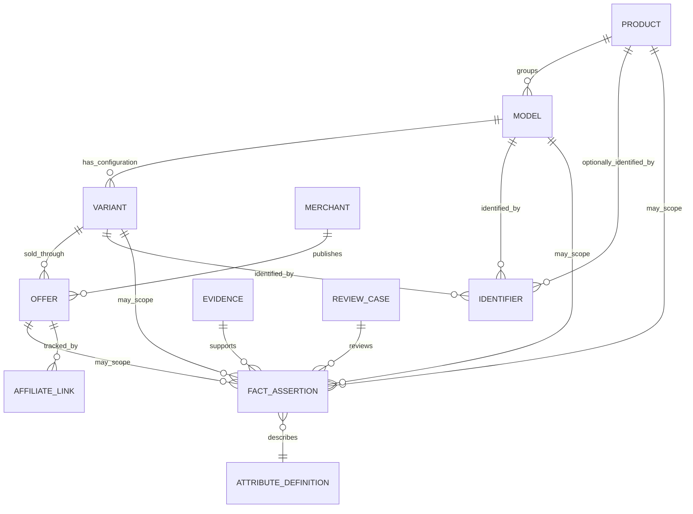
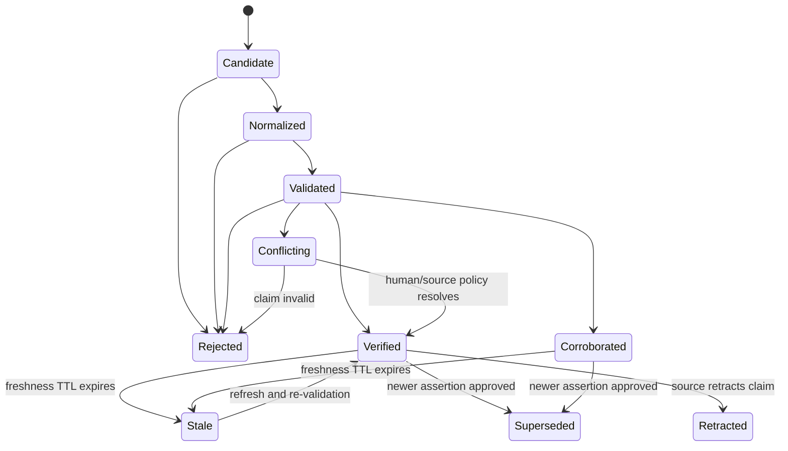

# A+ — Blueprint Reconciliation & Technical Contract

**Tài liệu:** `hoang-blueprint-reconciliation-v1.1.md`  
**Phiên bản:** 1.1 — Blueprint Reconciled / Owner Review Required  
**Ngày lập:** 12/11/2026  
**Phụ trách:** Hoàng — Technical Lead & Data Architecture  
**Liên kết công việc:** [PILOT-06 — Issue #11](https://github.com/anhnv14994/web-aff/issues/11)  
**Baseline:** `hoang-technical-feasibility-v1.md`  
**Phạm vi:** Reconcile kiến trúc, chuẩn hóa domain/data contract, decision API và vertical slice kiểm thử. Không triển khai production.

> **Trạng thái đối chiếu:** Đã đọc trực tiếp toàn bộ nội dung `Technical Blueprint & MVP Engineering Baseline v1.0` do người dùng cung cấp trong cuộc trò chuyện ngày 12/11/2026 và đối chiếu với feasibility v1.0 cùng contract draft này. Vì vậy, phần Blueprint crosswalk trong bản cập nhật đã được thực hiện trên nội dung gốc, không qua GitHub connector. Issue #11 comments và ROLE.md độc lập của Vân Anh/A Long/Trâm Anh chưa được cung cấp; các phần cần xác nhận chuyên môn/ownership vẫn được đánh dấu `[CONFIRM]`. Blueprint là baseline đề xuất, chưa phải production architecture được CEO phê duyệt.

---

## 0. Tóm tắt điều hành

PILOT-06 nên tạo ra một contract thống nhất để các module thu thập dữ liệu, catalog, validation, offer, decision và nội dung trao đổi với nhau mà không phụ thuộc vào một crawler, một nhà bán hoặc một ngành hàng cụ thể.

### 0.1. Các quyết định kỹ thuật đề xuất

| # | Quyết định | Contract đề xuất | Trạng thái |
|---|---|---|---|
| C1 | Phân cấp sản phẩm | `Product → Model → Variant → Offer`; SKU của merchant là mã cục bộ của listing/offer, không phải global identity | Đề xuất chuẩn hóa |
| C2 | Bằng chứng dữ liệu | `Evidence` là snapshot/nguồn có locator; `FactAssertion` là một claim về một thuộc tính, gắn với Evidence và subject cụ thể | Đề xuất chuẩn hóa |
| C3 | Nhiều nguồn | Lưu nhiều assertion song song; không ghi đè và không tự chọn majority khi có conflict | Bắt buộc trong contract |
| C4 | Trạng thái | Tách `value_state`, `assertion_status`, `entity_lifecycle` và `offer_status`; không gộp vào một `status` | Bắt buộc trong contract |
| C5 | Decision | `DecisionProfile` có version, hard constraints, soft preferences, weights và evidence policy; chỉ facts đủ điều kiện được dùng | Đề xuất chuẩn hóa |
| C6 | Abstain | API phải trả `insufficient_evidence`/`needs_review` khi thiếu, stale hoặc conflict ở field quan trọng | Bắt buộc trong contract |
| C7 | Kiến trúc | Modular monolith + background jobs + relational source of truth; adapter tách khỏi domain | Giữ định hướng feasibility v1.0, chờ đối chiếu Blueprint |
| C8 | Pilot | End-to-end vertical slice ngành màn hình, dùng bộ 16 model từ feasibility v1.0; triển khai trước một lát cắt nhỏ có fixtures và API tests | Đề xuất thực hiện |

### 0.2. Những gì bản này không làm

- Đã đối chiếu nội dung Technical Blueprint v1.0 được cung cấp; không tuyên bố Issue #11 comments hoặc các ROLE.md độc lập đã được đọc.
- Mapping decision flow bám sát các semantics ghi trong Blueprint (J1–J6, F1–F9, hard gate, soft score, coverage và question value filter); chi tiết định nghĩa J/F và golden fixtures vẫn cần Vân Anh xác nhận.
- Không quyết định taxonomy hoặc ngưỡng chuyên môn sản phẩm thay A Long.
- Không quyết định chính sách nguồn/affiliate thay Trâm Anh.
- Không tạo production database, crawler diện rộng, website hoặc production Decision Engine.

---

## 1. Reconciliation với Technical Blueprint v1.0

### 1.1. Tình trạng đầu vào và giới hạn kết luận

| Đầu vào | Trạng thái | Cách sử dụng / giới hạn |
|---|---|---|
| Feasibility v1.0 | Đã đọc từ workspace | Baseline về provenance, category schema, state, automation gates và pilot 16 màn hình |
| Technical Blueprint v1.0 | **Đã đọc nội dung gốc do người dùng dán trong chat** | Đã đối chiếu các mục 1–14; kết luận KEEP/ADAPT/ADD/DEFER ở bảng dưới |
| Issue #11 và comments | Chưa có nội dung comments | Scope PILOT-06 lấy từ brief; chưa xác nhận acceptance criteria bổ sung trong issue |
| ROLE.md Vân Anh/A Long/Trâm Anh | Chưa có file độc lập trong phiên | Chỉ dùng decision semantics, ownership và deliverables được nêu trực tiếp trong Blueprint; không suy diễn thêm |
| Báo cáo tâm lý hành vi v1.0 | Được Blueprint nói là đã rà soát, nhưng chưa có nội dung gốc trong phiên | Không tự định nghĩa J1–J6/F1–F9; yêu cầu Vân Anh cung cấp golden fixtures/định nghĩa nếu cần mapping sâu |

### 1.2. Kết luận reconciliation cấp cao

Blueprint v1.0 có nền tảng phù hợp để làm MVP engineering baseline: modular monolith, module ownership, canonical catalog, source/evidence, ingestion lifecycle, decision contract, affiliate isolation, analytics, quality gates và security/operations đều đã được đề cập. Không có căn cứ yêu cầu viết lại kiến trúc.

Các điểm cần chỉnh không phải “thiếu toàn bộ”, mà là **làm rõ semantics và đóng contract giữa các module**:

1. Blueprint định nghĩa `ProductModel` và `ProductVariant`, nhưng chưa có entity `Product` ở bảng canonical. Nếu A+ cần family/grouping thì thêm `Product` như grouping tùy chọn; nếu không, không ép thêm tầng.
2. `Offer` hiện có `model_id` và `variant_id` optional. Với offer dùng để clickout/mua một cấu hình cụ thể, cần yêu cầu `variant_id` resolved; model-level offer chỉ được giữ như dữ liệu chưa đủ điều kiện mua/decision cho đến khi mapping variant rõ.
3. Blueprint gộp các trường claim vào `Evidence/Assertion` trong một hàng entity. Nên tách Evidence (nguồn quan sát bất biến) và FactAssertion (claim có subject/attribute/value/status) để hỗ trợ nhiều claim từ một snapshot, nhiều nguồn cho một fact và conflict audit.
4. Decision semantics trong Blueprint rõ hơn contract draft ban đầu: hard FAIL → excluded; hard UNKNOWN/missing → verification_required; chỉ PASS toàn bộ hard constraints mới eligible. Cần bỏ cách diễn đạt generic `indeterminate` nếu làm mờ trạng thái `verification_required`.
5. Soft scoring có công thức cụ thể và coverage độc lập. Cần dùng đúng công thức Blueprint, đồng thời xử lý trường hợp không có known soft preference để tránh chia cho 0.
6. Blueprint quy định question orchestration dùng J1–J6, F1–F9 và question value filter; API phải giữ state/key/rule version, không tự chế định nghĩa các mã này.
7. Blueprint gọi PostgreSQL là ứng viên chứ chưa duyệt; feasibility/report không được diễn đạt như stack đã quyết định.

### 1.3. Crosswalk thực tế: Blueprint v1.0 → reconciliation v1.1

| Blueprint section/component | Nội dung gốc đã có | Disposition | Điều chỉnh/contract cần chốt |
|---|---|---|---|
| §1 Current state & missing inputs | Repo tài liệu, chưa thấy source code, migrations, tests, CI, deploy/runbook; nhiều quyết định kinh doanh/kỹ thuật còn thiếu | KEEP | Giữ nguyên giới hạn; không tuyên bố app đang chạy hoặc stack đã duyệt |
| §2 MVP scope | Modular monolith, canonical catalog, provenance, retries/idempotency, decision, clickout, tests, ops; loại trừ production và microservices | KEEP | Vertical slice phải là test harness/reference core, không phải website/deploy |
| §3 Module table | Catalog, Source & Evidence, Offer, Ingestion, Decision, Affiliate, Analytics, Admin/QA | KEEP + ADAPT | Gắn ownership/write boundary và contract events; Affiliate/Analytics không ghi vào suitability |
| ADR-001 | Modular monolith + worker | KEEP | Chỉ tách service khi tải/ownership chứng minh; không thêm queue/event streaming mặc định |
| ADR-002 | Relational canonical store + raw snapshots; PostgreSQL chỉ là ứng viên | KEEP + CLARIFY | Ghi rõ DB/vendor chưa được duyệt; raw snapshot tách khỏi canonical store |
| ADR-003 | Evidence là dữ liệu hạng nhất, có source/time/status/confidence/reviewer | ADAPT | Tách Evidence snapshot khỏi FactAssertion; confidence không thay verification |
| ADR-004 | Fit độc lập commission | KEEP — INVARIANT | Bổ sung metamorphic test thay commission/merchant/link mà ranking không đổi |
| ADR-005 | Hard UNKNOWN fail closed → verification_required | KEEP — INVARIANT | Candidate hard UNKNOWN không vào eligible/ranked list; không đổi thành PASS/FAIL |
| ADR-006 | Không auto-merge identity mơ hồ | KEEP — INVARIANT | Labeled set + measured threshold; ambiguity vào review queue |
| §5 Canonical model | ProductModel, ProductVariant, SpecificationDefinition, Evidence/Assertion, Source, Merchant, Offer, PriceObservation, Affiliate, Run/Exception, Decision, Events/Audit | ADAPT | Chuẩn hóa ranh giới Product grouping (optional), Model, Variant, Offer, Evidence, Assertion; Merchant SKU local |
| §6 Pipeline | Discover→Fetch→Store raw→Parse→Normalize→Validate→Match→Review→Upsert→Publish | KEEP | Thêm field-level assertion writes, replay contract, failure severity và publish gate |
| §7 Decision Engine | Profile, hard gate, soft score, coverage, explanation, question orchestration | KEEP + ADAPT | Dùng đúng công thức và status; version profile/rules; không tự tính fit từ raw specs |
| §8 API | Categories, products, sessions, questions, recommendations, compare, clickout, events | KEEP + ADAPT | Chuẩn hóa request/response, error codes, idempotency, profile version, no arbitrary redirect |
| §9 Affiliate/Analytics | Event contracts, controlled clickout, PII minimization, commission isolation | KEEP | Tách commercial tracking khỏi candidate scoring; event/outbox và dedupe |
| §10 Quality | P0 invariants và DATA/PIPE/DEC/API/AFF/OPS tests | KEEP + ADD | Bổ sung test assertion conflict resolution, exact variant offer, score denominator zero, profile/rule replay |
| §11 Security/ops | Secrets, least privilege, SSRF/open redirect, logs, metrics, alerts, backup/restore | KEEP | RPO/RTO/retention còn là quyết định CEO/ops; không tự đặt số |
| §12 Owners | CEO, A Long, Vân Anh, Affiliate owner/CEO, Trâm Anh | KEEP | Hoàng sở hữu contract/test implementation; domain criteria do owner chuyên môn duyệt |
| §13 Roadmap | E0–E5 | KEEP | Chỉ bắt đầu E1 sau khi E0 decisions đóng; E2/E3 vertical slice trước UI/affiliate thật |
| §14 Deliverables | Blueprint, schemas, reference core, tests, acceptance/security checklists | KEEP + CLARIFY | Đây là deliverables baseline; không đồng nghĩa artifacts đã tồn tại trong repo hoặc đã chạy CI |

### 1.4. Những điểm cần sửa trong chính contract v1.1

| Điểm trong draft cũ | Reconciliation theo Blueprint | Hành động |
|---|---|---|
| `Product → Model → Variant → Offer` như hierarchy bắt buộc | Blueprint chỉ định nghĩa ProductModel và ProductVariant; Product chưa phải entity bắt buộc | Đổi thành `Product (optional grouping) → ProductModel → ProductVariant → Offer`; cho phép Model không thuộc Product grouping |
| Evidence/FactAssertion đã tách như thể Blueprint định nghĩa cả hai | Blueprint ghi `Evidence/Assertion` gộp trong canonical entity table | Ghi rõ đây là ADAPT đề xuất nhằm bảo toàn snapshot và claim độc lập; cần chấp thuận trong contract |
| Offer bắt buộc gắn Variant | Blueprint cho phép `variant_id` optional | Offer thiếu variant mapping vẫn lưu được nhưng không eligible cho exact-variant clickout/recommendation nếu không chứng minh được scope |
| Hard UNKNOWN → `indeterminate` | Blueprint quy định `verification_required` | Chuẩn hóa candidate status thành `verification_required`; decision-level status có thể `completed_with_caveats` hoặc `insufficient_evidence` tùy toàn request |
| Soft UNKNOWN bị loại khỏi mẫu số score | Blueprint công thức score chỉ chia cho tổng weight của tiêu chí đã biết; coverage chia cho tổng weight toàn bộ preferences | Áp dụng đúng công thức §5; nếu không có tiêu chí known thì fit_score = null |
| Generic question flow | Blueprint nêu J1–J6, F1–F9, question value filter | API lưu `journey_state`, `friction_code`, `question_key`, `rule_version`; không tự gán ý nghĩa mã |
| PostgreSQL như lựa chọn gần như chốt | Blueprint nói PostgreSQL là ứng viên, hosting/vendor chờ duyệt | ADR phải ghi “candidate, pending CEO approval” |

### 1.5. Kết luận giữ/sửa/bổ sung

- **KEEP:** Modular monolith; worker; module boundaries; raw snapshot; retry/backoff/idempotency; validation/review queue; hard/soft separation; commission isolation; controlled clickout; P0 quality/security invariants.
- **ADAPT:** Catalog identity; Offer-to-Variant relationship; Evidence/Assertion split; decision status mapping; score/coverage formula; question orchestration contract; DB selection language.
- **ADD:** Product grouping optionality; field-level FactAssertion; assertion conflict set/resolution; decision replay fingerprint; explicit zero-known-preference behavior; offer exact-variant eligibility.
- **DEFER:** Microservices; event streaming; data lake; ML training; production crawler; production deployment; live affiliate integration until owner approvals.

### 1.6. Boundary decisions đã làm rõ từ Blueprint

**Catalog identity**
- `ProductModel` trong Blueprint tương ứng `Model` trong domain contract; `ProductVariant` tương ứng `Variant`.
- `Product` không có trong entity table gốc. Chỉ thêm nếu cần gom nhiều model thành family/grouping; không dùng nó làm bắt buộc trong mọi record.
- `merchant_sku` thuộc merchant listing/Offer scope, không phải global identity. MPN/GTIN cần `identifier_type + issuer + market/scope`.
- `Offer.model_id` được giữ để tương thích với baseline, nhưng `variant_id` phải được xác định trước khi offer được dùng để chọn nơi mua cho exact configuration. Nếu chưa resolve, gắn `identity_status=unresolved` và không bật CTA mua chính xác.

**Evidence / Assertion**
- Blueprint đã có Evidence/Assertion concept, source, timestamp, verification status, confidence và reviewer. Vì vậy không ghi “Blueprint thiếu provenance”.
- Contract v1.1 đề xuất chuẩn hóa thành hai object: `Evidence` (raw/source observation, hash, locator, fetched_at, connector version) và `FactAssertion` (subject, attribute, raw/normalized value, state/status, evidence ref, transform versions, review audit). Đây là refinement để hỗ trợ multi-claim/multi-source, không phải thay đổi triết lý Blueprint.
- Confidence chỉ là metadata hỗ trợ triage; không tự động nâng assertion thành verified.

**Decision**
- Candidate-level hard statuses là `eligible` (mọi hard PASS), `excluded` (có hard FAIL), `verification_required` (có hard UNKNOWN/missing). Nếu có đồng thời FAIL và UNKNOWN, FAIL vẫn loại candidate; lưu cả hai checks để giải thích, không làm candidate eligible.
- Soft score chỉ tính trên soft criteria đã biết; coverage tính trên toàn bộ soft preference weights. Nếu không có known criteria hoặc tổng weight bằng 0, score là `null`; không chia cho 0 và không xếp hạng giả.
- Commission/revenue/EPC không được truyền vào Decision Profile hoặc evaluator. Có thể dùng ở analytics/affiliate reporting riêng.
- Question API cần `journey_state`, `friction_codes`, `answered_slots`, `question_key`, `question_policy_version`, `no_question_reason`; J/F semantics do Vân Anh sở hữu.

## 2. Canonical domain model: Product / Model / Variant / Offer / Evidence

### 2.1. Quan hệ tổng thể



> Đây là quan hệ logic. Khi triển khai schema vật lý, subject của FactAssertion nên dùng một kiểu tham chiếu có kiểm soát (ví dụ `subject_type + subject_id` với FK được kiểm tra bằng domain service, hoặc các bảng assertion theo subject type). Không dùng polymorphic reference không có integrity checks.

### 2.2. Định nghĩa entity chuẩn

| Entity | Định nghĩa contract | Identity / key | Không được nhầm với |
|---|---|---|---|
| `Product` | Node canonical cấp catalog, gom các Model cùng một dòng/family mà người dùng hiểu là cùng nhóm sản phẩm | Internal immutable `product_id`; canonical slug/name chỉ là display | Không mặc định Product là SKU bán được; không dùng Product ID của merchant |
| `Model` | Model do nhà sản xuất định danh bằng model code/series cụ thể, trong phạm vi brand, region/revision nếu cần | `model_id`; unique candidate key gồm brand + manufacturer model code + scope; không dựa riêng vào tên marketing | Product family; merchant listing; variant |
| `Variant` | Cấu hình hoặc trade-item cụ thể có khác biệt ảnh hưởng tới thông số, tính tương thích hoặc mua hàng | `variant_id`; maker part/config code và identifiers như GTIN nếu có, scoped theo issuer/market | Model tổng quát; Merchant SKU; Offer |
| `Offer` | Một cơ hội mua hàng cụ thể do một Merchant cung cấp cho một Variant, ở một thời điểm/market/channel | `offer_id`; merchant + listing ID/URL + variant mapping; có history | Variant; product page chính thức; affiliate link |
| `Merchant` | Nhà bán/retailer/merchant xác định được | `merchant_id`; canonical domain/account | Brand/manufacturer |
| `Identifier` | Mã định danh có type, issuer, scope và value | `(identifier_type, issuer, scope, value)`; uniqueness theo type rules | Tên sản phẩm; SKU không rõ issuer |
| `Evidence` | Bản ghi bất biến về nguồn quan sát được hoặc tài liệu đã lấy, đủ để kiểm lại claim | `evidence_id`; source ID + snapshot ID/hash + locator | Chỉ một URL sống; chính fact đã chuẩn hóa |
| `FactAssertion` | Một claim đơn lẻ về một attribute của một subject với raw/normalized value và bằng chứng | `assertion_id`; subject + attribute + evidence + extraction context | “Giá trị đúng cuối cùng” không có lịch sử |
| `AttributeDefinition` | Định nghĩa semantics/kiểu/đơn vị/policy của một field trong category schema version | category + schema version + attribute key | Label giao diện hoặc prompt AI |
| `AffiliateLink` | Tracking destination/redirect riêng cho chương trình affiliate hoặc campaign và offer | `affiliate_link_id`; program + offer + target + tracking metadata | Offer; URL gốc của merchant |
| `ReviewCase` | Công việc cần con người phân xử identity, assertion, source hoặc policy | `review_case_id`; case type + linked records + resolution | Trạng thái `conflicting` tự nó |

### 2.3. Ranh giới Product → Model → Variant

**Quy tắc 1 — Product là nhóm canonical, Model là thiết kế/model code, Variant là cấu hình cụ thể.** Tên thương mại không đủ để merge.

**Quy tắc 2 — Quan hệ nhiều-nhiều từ nguồn về canonical entity phải được quản lý bằng mapping.** Một source listing có thể nhắc nhiều variant; một variant có thể xuất hiện trong nhiều merchant listings.

**Quy tắc 3 — Không được buộc mọi Product phải có nhiều Model.** Với catalog nhỏ, Product có thể chỉ có một Model. Nếu nguồn không chứng minh được family relationship, hệ thống tạo Product và Model tạm thời theo quan hệ 1:1 hoặc để candidate, không suy đoán Product Family.

**Quy tắc 4 — Variant chỉ được tạo khi khác biệt có ý nghĩa.** Màu sắc có thể là Variant nếu khác trade item/GTIN hoặc người mua cần chọn riêng; spelling/packaging typo không tự tạo Variant. Field semantics phải do A Long duyệt.

**Quy tắc 5 — Merchant SKU là local identifier.** Giá trị `SKU-123` chỉ unique trong phạm vi merchant/account/site đã xác định; tuyệt đối không merge 2 variant chỉ vì merchant SKU trùng ở hai merchant.

**Quy tắc 6 — Model không kế thừa thông số variant theo cách làm mất provenance.** Có thể expose effective view cho API, nhưng từng fact vẫn phải giữ `subject_type`, nguồn và inheritance rule. Ví dụ RAM 16 GB chỉ ở một variant không được đưa lên cấp Model nếu không áp dụng cho tất cả variant.

### 2.4. Evidence và FactAssertion

Evidence lưu “đã quan sát gì, ở đâu, khi nào”; FactAssertion lưu “nguồn đó nói gì về subject/attribute nào”.

**Evidence tối thiểu:**

| Field | Required | Giải thích |
|---|---|---|
| `evidence_id` | Yes | Internal immutable identifier |
| `source_id` | Yes | Registry ID của nguồn/connector |
| `source_type` | Yes | manufacturer, retailer, affiliate_feed, manual, lab, review… |
| `source_uri` | Khi có | URL/API/document reference đã lấy |
| `snapshot_uri` | Với dữ liệu thô có thể lưu | Object storage URI hoặc artifact reference |
| `content_hash` | Yes | Hash snapshot/payload để audit và deduplicate |
| `fetched_at` | Yes | Thời điểm A+ lấy được nội dung |
| `published_at` | Nếu nguồn công bố | Thời điểm nguồn nói dữ liệu có hiệu lực/công bố |
| `source_locator` | Yes cho field assertion | CSS selector, JSON pointer/path, page/section, table/row hoặc quote span |
| `locale` / `market` | Khi áp dụng | Giúp tách region, currency, language |
| `access_result` | Yes | success, blocked, timeout, not_found, parse_error… |
| `connector_version` | Yes | Phiên bản adapter/connector |

**FactAssertion tối thiểu:**

| Field | Required | Giải thích |
|---|---|---|
| `assertion_id` | Yes | Immutable ID của một claim |
| `subject_type`, `subject_id` | Yes | `product`, `model`, `variant` hoặc `offer` |
| `attribute_key`, `schema_version` | Yes | Field semantics đã version |
| `value_state` | Yes | known, unknown, not_disclosed, not_applicable |
| `raw_value`, `raw_unit` | Nếu known | Value nguyên bản từ source |
| `normalized_value`, `normalized_unit` | Nếu parse được | Value typed để query/compare |
| `evidence_id`, `source_locator` | Yes khi known | Bằng chứng cụ thể cấp field |
| `assertion_status` | Yes | candidate/validated/verified/conflicting… |
| `observed_at` | Yes | Khi hệ thống quan sát claim |
| `valid_from`, `valid_until` | Nếu xác định được | Khoảng thời gian claim/offer có hiệu lực |
| `extractor_type`, `extractor_version` | Yes | rule/parser/AI/human + version |
| `normalizer_version` | Yes | Version chuyển đổi raw → normalized |
| `reviewed_by`, `reviewed_at` | Nếu có | Human decision audit |
| `supersedes_assertion_id` | Nếu thay thế | Giữ lịch sử, không overwrite |

**Một Evidence có thể hỗ trợ nhiều FactAssertion; một attribute có nhiều assertion.** Không bắt buộc mỗi assertion phải đến từ một URL khác nhau, nhưng locator phải chỉ ra chính xác vùng hỗ trợ claim.

### 2.5. Ví dụ hợp nhất dữ liệu

Ví dụ dưới đây là fixture giả lập, không phải thông số của sản phẩm thật:

```json
{
  "product": {"product_id": "prd_001", "canonical_name": "Example 27-inch monitor family"},
  "model": {"model_id": "mdl_001", "product_id": "prd_001", "manufacturer_model_code": "EX27Q"},
  "variant": {"variant_id": "var_001", "model_id": "mdl_001", "manufacturer_variant_code": "EX27Q-BK", "market": "VN"},
  "offer": {"offer_id": "off_001", "variant_id": "var_001", "merchant_id": "mer_001", "merchant_sku": "SKU-A91", "currency": "VND", "offer_status": "active"},
  "evidence": {"evidence_id": "ev_001", "source_id": "src_manufacturer", "content_hash": "sha256:example", "fetched_at": "2026-11-12T03:00:00Z", "source_locator": "specs/display/resolution"},
  "assertion": {"assertion_id": "ast_001", "subject_type": "model", "subject_id": "mdl_001", "attribute_key": "display.native_resolution", "raw_value": "2560 x 1440", "normalized_value": {"horizontal": 2560, "vertical": 1440}, "normalized_unit": "pixel", "value_state": "known", "assertion_status": "candidate", "evidence_id": "ev_001"}
}
```

Điểm quan trọng: assertion này mới là `candidate`, dù có Evidence; có nguồn không đồng nghĩa fact đã được verified. Quy trình validation/review mới quyết định status có thể dùng trong Decision.

---

## 3. Chuẩn hóa data state và lifecycle

Không dùng một enum duy nhất như `status=active/verified/stale` cho mọi loại bản ghi. Đây là các chiều khác nhau.

### 3.1. Bốn chiều state độc lập

1. **Value state:** Có biết giá trị hay không, và lý do không có giá trị.
2. **Assertion status:** Claim đã được xử lý/xác minh đến đâu.
3. **Entity lifecycle:** Catalog entity còn là model đang lưu hành, discontinued hay archived.
4. **Offer status:** Offer hiện còn mua được không.

Ngoài ra có **ReviewCase state** để theo dõi công việc của con người.

### 3.2. Value state

| State | Ý nghĩa | Ví dụ | Decision usage |
|---|---|---|---|
| `known` | Có giá trị xác định | `27`, `IPS`, `144` | Chỉ usable nếu assertion status/freshness đạt policy |
| `unknown` | Chưa biết/chưa thu thập được | Chưa có thông số | Không được hiểu là false/zero |
| `not_disclosed` | Đã kiểm tra source phù hợp nhưng nguồn không công bố | Manual không nêu độ sáng | Không được suy ra có hoặc không |
| `not_applicable` | Thuộc tính không áp dụng cho subject | Laptop không có cổng DVI | Bỏ khỏi scoring/constraint theo policy; không tự set false |

`missing` nên là trạng thái completeness của payload/field, không phải canonical value. Khi đã xử lý phải ánh xạ thành `unknown`, `not_disclosed` hoặc `not_applicable` theo lý do.

### 3.3. Assertion status

| Status | Điều kiện vào | Có dùng trong Decision không? | Chuyển tiếp |
|---|---|---|---|
| `candidate` | Vừa ingest/extract, chưa validation | No | normalized / rejected |
| `normalized` | Parse/unit/category mapping xong | No, trừ profile debug | validated / rejected |
| `validated` | Qua structural + deterministic business rules | Theo policy, mặc định chưa đủ với critical fields | verified / corroborated / conflicting / rejected |
| `verified` | Đạt field-specific source policy hoặc human-approved | Yes trong freshness/identity scope | stale / superseded / retracted / conflicting nếu có evidence mới |
| `corroborated` | Có corroboration độc lập theo policy; không có conflict unresolved | Yes nếu profile cho phép | stale / superseded / conflicting / retracted |
| `conflicting` | Assertion set không thể đồng thời đúng trong cùng scope/condition | No cho attribute liên quan | verified/corroborated sau resolution hoặc rejected |
| `stale` | Assertion từng usable nhưng quá TTL/valid_until | No cho current decision | verified sau refresh hoặc superseded |
| `rejected` | Parser/rule/human xác định sai, sai subject hoặc unsupported | No | Terminal; chỉ thay bằng assertion mới |
| `superseded` | Có assertion revision mới thay thế; bản cũ giữ lại | No cho current view; yes for audit | Terminal historical |
| `retracted` | Source rút claim hoặc A+ nhận ra không còn căn cứ | No | Terminal historical |

`stale` nên được tính lại dựa vào freshness policy và `observed_at/valid_until`; có thể materialize để tìm kiếm nhưng phải ghi `stale_reason` và `evaluated_at`. Không chỉ dựa trên một cờ boolean bất biến.

### 3.4. Entity lifecycle

Áp dụng cho Product/Model/Variant, không áp dụng cho Offer.

| State | Ý nghĩa | Lưu ý |
|---|---|---|
| `draft` | Entity candidate đang được dựng | Không public/decision eligible |
| `active` | Entity đã định danh và đang được quản lý | Không khẳng định sản phẩm còn bán ở mọi merchant |
| `discontinued` | Nhà sản xuất/nguồn có thẩm quyền xác nhận ngừng sản xuất/kinh doanh model | Cần evidence và thời điểm; không đồng nghĩa hết stock mọi nơi |
| `end_of_life` | Hết vòng đời support/maintenance hoặc trạng thái tương ứng theo taxonomy | Phải định nghĩa theo ngành và nguồn; có thể tách khỏi discontinued |
| `merged` | Record được hợp nhất vào canonical entity khác | Giữ redirect/alias và merge audit; không xóa lịch sử |
| `archived` | Không còn dùng trong current catalog nhưng vẫn giữ audit | Không có nghĩa dữ liệu bị xóa |
| `identity_ambiguous` | Chưa đủ để xác định exact entity | Không dùng cho decision |

### 3.5. Offer lifecycle

| State | Nghĩa | Hành vi UI/Decision |
|---|---|---|
| `discovered` | Vừa tìm thấy listing, chưa xác minh identity/availability | Không hiển thị CTA như offer active |
| `active` | Listing/price/target được kiểm tra và còn hiệu lực trong TTL | Có thể hiển thị cùng `observed_at` |
| `out_of_stock` | Seller xác nhận hoặc feed báo hết hàng | Không xếp hạng là nơi mua ngay |
| `unavailable` | Trang/feed tạm không truy cập hoặc listing tạm mất | Không coi ngay là discontinued |
| `expired` | `valid_until` qua hạn hoặc campaign kết thúc | Ngừng CTA/affiliate route theo policy |
| `discontinued` | Merchant/partner xác nhận listing/offer đóng vĩnh viễn | Giữ lịch sử; không hiển thị current |
| `suspect` | Giá bất thường, redirect sai, mapping variant mơ hồ hoặc feed drift | Quarantine/review; không publish |
| `invalid` | Link/offer xác minh sai hoặc không hợp lệ | Ngừng sử dụng; giữ audit |

### 3.6. ReviewCase lifecycle

`open → triaged → awaiting_owner → resolved_approved | resolved_rejected | unresolved | cancelled`.

- `resolved_approved` phải tạo hoặc promote assertion/mapping với `reviewed_by`, `reviewed_at`, reason và source evidence.
- `resolved_rejected` không xóa evidence; ghi lý do bác bỏ.
- `unresolved` là kết quả hợp lệ; tiếp tục block field/identity liên quan.
- Case không tự đóng chỉ vì AI đề xuất một đáp án.

### 3.7. Lifecycle tổng quát



Lifecycle trên là của assertion. Entity lifecycle và Offer lifecycle quản lý riêng như bảng 3.4–3.5.

---

## 4. Technical contract: shared schemas và API

### 4.1. Contract principles

- Tất cả ID nội bộ là opaque, immutable và không encode tên/model/giá vào ID.
- Tất cả thời gian API dùng ISO 8601 UTC (`Z`), trừ field được ghi rõ timezone địa phương theo nguồn.
- Giá luôn có amount dạng decimal/string decimal, `currency` ISO 4217 và `observed_at`; không dùng float binary làm money type.
- Mọi field có semantics theo `schema_version`.
- Mọi request có thể retry phải có `Idempotency-Key` hoặc deterministic operation key.
- API trả `contract_version`, `schema_version`/`profile_version` phù hợp và `trace_id`.
- `null`, absent và `value_state` có semantics riêng; không coi `null` là `false` hoặc `0`.
- Internal IDs không được thay bằng URL/MPN/SKU trong foreign key.

### 4.2. Shared object shapes (logical contract)

#### Product / Model / Variant

```json
{
  "product_id": "prd_...",
  "canonical_name": "...",
  "category_id": "monitor",
  "lifecycle_status": "active",
  "schema_version": "monitor.v1",
  "models": [
    {
      "model_id": "mdl_...",
      "manufacturer_model_code": "...",
      "brand_id": "br_...",
      "market_scope": ["VN"],
      "lifecycle_status": "active",
      "variants": [
        {
          "variant_id": "var_...",
          "manufacturer_variant_code": "...",
          "identifiers": [
            {"type": "GTIN", "issuer": "GS1", "scope": "VN", "value": "..."}
          ],
          "configuration_signature": "sha256:...",
          "lifecycle_status": "active"
        }
      ]
    }
  ]
}
```

Fixture trên là object shape; placeholder không phải sản phẩm thật. `models`/`variants` có thể được phân trang thay vì nhúng sâu khi catalog lớn.

#### Offer

```json
{
  "offer_id": "off_...",
  "variant_id": "var_...",
  "merchant_id": "mer_...",
  "merchant_listing_id": "listing-...",
  "merchant_sku": "merchant-local-sku",
  "market": "VN",
  "price": {"amount": "12990000", "currency": "VND", "price_type": "current"},
  "availability": "in_stock",
  "condition": "new",
  "offer_status": "active",
  "offer_uri": "https://merchant.example/item",
  "observed_at": "2026-11-12T03:00:00Z",
  "valid_until": null,
  "affiliate_link_id": "afl_...",
  "evidence_ids": ["ev_..."]
}
```

Contract phải tách `price_type` (list/current/sale/starting/financing), phí ship, voucher/loyalty condition và giá cuối cùng nếu source có. Không tự diễn giải voucher có điều kiện thành giá phổ thông.

#### Evidence

```json
{
  "evidence_id": "ev_...",
  "source_id": "src_...",
  "source_type": "manufacturer",
  "source_uri": "https://manufacturer.example/spec",
  "snapshot_uri": "object://raw/sha256/...",
  "content_hash": "sha256:...",
  "fetched_at": "2026-11-12T03:00:00Z",
  "published_at": null,
  "locale": "vi-VN",
  "market": "VN",
  "access_result": "success",
  "connector_version": "manufacturer-web.v2"
}
```

#### FactAssertion

```json
{
  "assertion_id": "ast_...",
  "subject": {"type": "variant", "id": "var_..."},
  "attribute": {"key": "display.refresh_rate_native_hz", "schema_version": "monitor.v1"},
  "value_state": "known",
  "raw_value": "165 Hz (overclocked)",
  "raw_unit": null,
  "normalized_value": {"value": 165, "mode": "overclocked"},
  "normalized_unit": "Hz",
  "evidence": {"evidence_id": "ev_...", "locator": "specs/display/refresh-rate"},
  "assertion_status": "candidate",
  "observed_at": "2026-11-12T03:00:00Z",
  "extractor": {"type": "rule", "version": "monitor-parser.v3"},
  "normalizer_version": "units.v1"
}
```

#### AttributeDefinition

```json
{
  "category_id": "monitor",
  "schema_version": "monitor.v1",
  "attribute_key": "display.refresh_rate_native_hz",
  "value_type": "integer",
  "unit": "Hz",
  "allowed_range": {"min": 20, "max": 1000},
  "enum_values": null,
  "required_for_decision": false,
  "criticality": "high",
  "source_policy_id": "monitor-refresh-rate.v1",
  "freshness_policy_id": "static-spec.v1",
  "validation_rule_ids": ["positive-integer", "native-vs-overclocked"],
  "display_label": "Tần số quét gốc"
}
```

`allowed_range` là sanity bound kỹ thuật, không phải cơ sở để AI đoán giá trị bị thiếu.

### 4.3. Internal API surface đề xuất

Tên đường dẫn là proposal; đối chiếu với naming và framework trong Blueprint trước khi implementation.

| API | Verb | Vai trò | Quyền/guard |
|---|---|---|---|
| `/v1/ingestion/runs` | POST | Tạo ingestion run theo source/market/category | Connector auth; idempotency |
| `/v1/evidence` | POST | Đăng ký snapshot/evidence metadata | Không nhận canonical facts trực tiếp |
| `/v1/catalog/products` | POST | Tạo Product candidate hoặc idempotent upsert | Catalog service |
| `/v1/catalog/models` | POST | Tạo/map Model candidate | Identity policy; ambiguous → review |
| `/v1/catalog/variants` | POST | Tạo/map Variant | Exact mapping/variant rule; no fuzzy auto-merge |
| `/v1/facts/assertions` | POST | Ghi FactAssertion candidate | Evidence reference bắt buộc với known value |
| `/v1/facts/assertions/{id}/validate` | POST | Chạy deterministic rules/source policy | Validator service |
| `/v1/reviews/cases` | GET/POST | Tạo/đọc review case | Human reviewer role |
| `/v1/reviews/cases/{id}/resolve` | POST | Approve/reject/leave unresolved | Authorized reviewer + reason |
| `/v1/offers` | POST/PATCH | Đăng ký offer observation/lifecycle | Merchant/source contract; append history |
| `/v1/affiliate-links/{id}/checks` | POST | Ghi link check result | Allowlist, redirect policy |
| `/v1/decision-profiles/{id}` | GET | Lấy profile cụ thể/version | Read-only với Decision API |
| `/v1/decisions/evaluate` | POST | Đánh giá candidates theo profile | Chỉ đọc eligible facts/offers |
| `/v1/decisions/{id}` | GET | Lấy kết quả, reasons, evidence refs | Audit/read policy |

**Không bắt buộc triển khai tất cả endpoints trong pilot.** Vertical slice cần tối thiểu ingestion fixture, Evidence, Product/Model/Variant, FactAssertion, validation, review fixture, Offer và `POST /v1/decisions/evaluate`.

### 4.4. Validation API behavior

- Validation là side-effect được audit; response phải liệt kê rule IDs, field path, severity và outcome.
- Không update assertion đã tồn tại theo kiểu in-place để đổi raw value; tạo assertion mới và liên kết `supersedes_assertion_id`.
- Structural validation (schema/type/unit) phải tách semantic validation (identity, source authority, mode/region applicability).
- Rule failure ở critical field tạo `rejected` hoặc `conflicting` tùy bản chất; không tự gắn `verified` chỉ vì JSON hợp lệ.

Response shape minh họa:

```json
{
  "assertion_id": "ast_...",
  "validation_run_id": "val_...",
  "outcome": "needs_review",
  "assertion_status": "conflicting",
  "issues": [
    {
      "rule_id": "same-scope-refresh-rate-consistency.v1",
      "severity": "blocking",
      "field": "display.refresh_rate_native_hz",
      "code": "CONFLICTING_ASSERTIONS",
      "message": "Multiple claims remain incompatible for the same model/variant and operating mode."
    }
  ],
  "review_case_id": "rev_..."
}
```

---

## 5. Decision Flow của Vân Anh → Decision Profile / API

### 5.1. Cơ sở và giới hạn mapping

Mapping này bám theo các semantics có trong Blueprint §7: state J1–J6, friction F1–F9, question value filter, hard gate, soft preference score, evidence coverage và explanation. Tuy nhiên, định nghĩa đầy đủ từng J/F và golden fixtures T01–T14 không nằm trong nội dung Blueprint được cung cấp; Hoàng không tự đặt ý nghĩa cho các mã đó. Vân Anh vẫn cần xác nhận dictionary, transitions, slot keys và expected outcomes. Hoàng chịu trách nhiệm chuyển semantics đã duyệt thành API/profile/tests, không tự quyết định tiêu chí phù hợp.

### 5.2.1. Mapping bắt buộc theo Blueprint v1.0

| Blueprint behavior | Technical representation | Contract / test |
|---|---|---|
| Journey state J1–J6 | `journey_state` enum/key trong DecisionSession; state transition log | Không hard-code ý nghĩa ngoài dictionary Vân Anh duyệt; test transition theo fixture |
| Friction F1–F9 | `friction_code` hoặc set of observed friction signals gắn session/turn | Giữ nguyên code, timestamp và rule version; không biến friction thành product fact |
| Không hỏi slot đã có câu trả lời | `profile.answered_slots` / `known_slots` và `question_key` | `next-question` không trả lại slot đã answered trừ khi câu trả lời bị invalidated |
| Ưu tiên hard blockers | Question value/priority policy tham chiếu unresolved hard constraints | Câu hỏi làm rõ blocker có decision value cao hơn câu hỏi soft khi policy xác nhận |
| Question value filter | `question_policy_version`, `question_value`, `expected_decision_impact` | Nếu không có câu hỏi đạt filter: `no_question` thay vì hỏi cho đủ form |
| Hard PASS | Candidate hard check `pass` | Chỉ PASS mọi hard constraint mới `eligible` |
| Hard FAIL | Candidate `excluded` | Không thể được cứu bởi soft score cao |
| Hard UNKNOWN/missing | Candidate `verification_required` | Không vào eligible/ranked list; trả missing evidence/required slot |
| Soft fit 0/1/2/null | Per-criterion `fit_level` nullable, `weight`, `evidence_refs` | null là unknown, không cast về 0 |
| Fit score | `100 * Σ(weight_i * fit_i) / (2 * Σ(weight_i của tiêu chí đã biết))` | Chỉ known soft criteria; nếu mẫu số 0 thì `fit_score=null` |
| Evidence coverage | `Σ(weight_i đã biết) / Σ(weight_i của toàn bộ soft preferences)` | Trả riêng score; không dùng coverage để giả mạo score |
| Explanation | Strengths, tradeoffs, unknowns, reasons + assertion/evidence refs | Mọi claim giải thích trace được về evidence đã duyệt |
| Deterministic ranking | Stable tie-breaker theo candidate ID | Cùng input/profile/ruleset cho cùng output; merchant/commission không đổi ranking |

**Lưu ý:** Blueprint nêu hard UNKNOWN là `verification_required`, không phải hard FAIL. Candidate có bất kỳ hard FAIL nào vẫn `excluded`; lưu mọi check để giải thích. Decision-level status (`completed`, `completed_with_caveats`, `needs_clarification`, `insufficient_evidence`, `no_eligible_candidate`, `needs_review`, `failed`) phải tách khỏi candidate eligibility.

### 5.2. Flow-to-contract mapping

| Bước nghiệp vụ (generic) | Contract/API | Dữ liệu vào | Xử lý | Output / failure mode | Owner xác nhận |
|---|---|---|---|---|---|
| Need intake | `DecisionRequest.user_need` | Category, market, budget, use case, constraints | Validate type/range/enum; không tự suy diễn câu trả lời còn thiếu | normalized need + unresolved questions | Vân Anh |
| Mandatory constraints | `DecisionProfile.hard_constraints[]` | Attribute key, operator, target | Eligibility filter; chỉ đánh giá nếu field usable | pass/fail/unknown per constraint | Vân Anh + A Long |
| Preferences | `soft_preferences[]` | Preference, importance, direction | Map thành score component theo profile version | component score + explanation | Vân Anh |
| Evidence gate | `evidence_policy` | Fact status, evidence type, freshness, identity | Exclude stale/conflict/candidate hoặc đánh dấu unknown | evidence admissibility per field | Hoàng + A Long |
| Candidate ranking | `ranking_policy` | Eligible candidate features | Weighted score/lexicographic rules; normalize theo profile | ranked list + score breakdown | Vân Anh |
| Explain result | `explanation_policy` | Selected evidence-backed reasons | Chỉ generate reasons từ fields usable | reason codes + assertion/evidence refs | Vân Anh + Hoàng |
| Ask/abstain | `abstain_policy` | Missing/conflicts/low candidate coverage | Nếu hard constraint unknown hoặc evidence coverage thấp: ask/abstain | `insufficient_evidence` / `needs_clarification` | Vân Anh + CEO |
| Commercial action | Offer selection policy | Active offers, price freshness, affiliate checks | Chỉ hiển thị offer usable và link pass | offer options/none_available | Trâm Anh |

### 5.3. DecisionProfile schema

Một DecisionProfile là policy versioned, không phải prompt AI tự sinh mỗi lần request.

```json
{
  "profile_id": "monitor-office-value",
  "profile_version": "1.0.0",
  "category_id": "monitor",
  "market": "VN",
  "goal": "recommend_monitor_for_office_work",
  "hard_constraints": [
    {
      "constraint_id": "budget_max",
      "attribute_key": "offer.current_price_amount",
      "operator": "lte",
      "value_source": "request.budget_max",
      "required": true,
      "unknown_policy": "indeterminate"
    }
  ],
  "soft_preferences": [
    {
      "preference_id": "screen_size",
      "attribute_key": "display.diagonal_inch",
      "direction": "target_range",
      "target": {"min": 24, "max": 27},
      "weight": 0.3
    }
  ],
  "evidence_policy": {
    "allowed_assertion_statuses": ["verified", "corroborated"],
    "max_age_policy_by_attribute": {
      "offer.current_price_amount": "price-short-ttl.v1",
      "display.diagonal_inch": "static-spec.v1"
    },
    "block_on_conflict": true,
    "require_exact_variant_for_offer": true
  },
  "ranking_policy": {
    "method": "weighted_sum",
    "normalize_components": true,
    "minimum_profile_coverage": 0.8,
    "minimum_candidate_count": 1
  },
  "abstain_policy": {
    "on_unknown_hard_constraint": "return_indeterminate",
    "on_conflicting_critical_fact": "exclude_candidate_and_explain",
    "on_no_eligible_candidate": "insufficient_evidence_or_no_match",
    "do_not_impute_missing_values": true
  },
  "explanation_policy": {
    "require_evidence_for_positive_claim": true,
    "include_tradeoffs": true,
    "include_missing_critical_fields": true
  }
}
```

Đây là profile fixture minh họa semantics, không phải logic sản phẩm đã được Vân Anh phê duyệt. Giá trị weight, target range và coverage threshold không được coi là quyết định kinh doanh.

### 5.4. DecisionRequest

```json
{
  "request_id": "req_...",
  "profile_id": "monitor-office-value",
  "profile_version": "1.0.0",
  "market": "VN",
  "user_need": {
    "budget_max": {"amount": "7000000", "currency": "VND"},
    "use_case": ["office", "spreadsheet"],
    "preferred_size_inch": {"min": 24, "max": 27},
    "must_have": ["height_adjustment"]
  },
  "candidate_scope": {"product_ids": ["prd_001", "prd_002"]},
  "as_of": "2026-11-12T03:00:00Z"
}
```

### 5.5. DecisionResponse

```json
{
  "decision_id": "dec_...",
  "request_id": "req_...",
  "profile": {"profile_id": "monitor-office-value", "profile_version": "1.0.0"},
  "decision_status": "completed_with_caveats",
  "eligible_candidates": [
    {
      "variant_id": "var_001",
      "rank": 1,
      "score": 0.82,
      "score_components": [
        {"preference_id": "screen_size", "score": 1.0, "weight": 0.3, "assertion_ids": ["ast_001"]}
      ],
      "reasons": [
        {"code": "MATCHED_PREFERRED_SIZE", "assertion_ids": ["ast_001"], "evidence_ids": ["ev_001"]}
      ],
      "tradeoffs": [],
      "offer_options": ["off_001"]
    }
  ],
  "excluded_candidates": [
    {"variant_id": "var_002", "reason_code": "HARD_CONSTRAINT_NOT_MET", "constraint_id": "budget_max", "assertion_ids": ["ast_002"]}
  ],
  "indeterminate_candidates": [
    {"variant_id": "var_003", "reason_code": "INSUFFICIENT_EVIDENCE", "missing_or_blocked_attributes": ["ergonomics.height_adjustment"]}
  ],
  "coverage": {"required_fields": 4, "usable_fields": 3, "ratio": 0.75},
  "evidence_summary": {"verified": 3, "corroborated": 1, "stale": 1, "conflicting": 1},
  "warnings": ["One candidate was not ranked because a mandatory attribute could not be verified."],
  "trace_id": "trace_..."
}
```

Không trả score giả chính xác khi profile chưa xác định scoring semantics. Nếu một hard constraint không rõ do thiếu fact, không biến thành fail hoặc pass; trả `indeterminate`.

### 5.6. Decision statuses chuẩn

| Status | Ý nghĩa |
|---|---|
| `completed` | Đã đánh giá đủ dữ liệu theo profile; có thể có eligible/excluded |
| `completed_with_caveats` | Có kết quả nhưng một số candidate bị indeterminate hoặc có warning |
| `needs_clarification` | Thiếu thông tin từ user để xác định request/profile |
| `insufficient_evidence` | Dữ liệu catalog không đủ/không đủ freshness/evidence để ra kết quả tin cậy |
| `no_eligible_candidate` | Dữ liệu đủ để đánh giá, nhưng không candidate nào đạt hard constraints |
| `needs_review` | Identity/conflict/policy cần người kiểm tra trước khi trả lời chắc chắn |
| `failed` | Lỗi kỹ thuật, không phải kết quả nghiệp vụ |

Tách status của decision khỏi status của từng candidate. Một response có thể `completed_with_caveats` đồng thời có candidate `eligible`, `excluded` và `indeterminate`.

### 5.7. Decision rules không được vi phạm

1. Candidate phải có identity đủ tin cậy trước khi xét specs.
2. `candidate`, `normalized`, `conflicting`, `stale`, `rejected`, `unknown` không được dùng như verified values.
3. Một giá trị `not_disclosed` không được coi là “không có tính năng”.
4. Hard constraint với unknown phải ra `indeterminate` theo profile, không mặc định pass hoặc fail.
5. Không ranking trên field có conflict unresolved.
6. Mọi reason/claim phải trace được về assertion và Evidence; score phải trace được về profile version và component scores.
7. AI được phép diễn đạt kết quả đã có; không được tự thay đổi eligibility, trọng số hoặc tạo fact mới.
8. Không dùng score tổng để che giấu hard constraint fail.
9. Offer selection phải kiểm tra Variant identity, Offer status, price freshness và affiliate link status độc lập với specs.
10. Decision record phải lưu `profile_version`, `as_of`, candidate set fingerprint, assertion IDs và engine version để replay/audit.

---

## 6. Vertical slice đề xuất có thể kiểm thử

### 6.1. Mục tiêu vertical slice

Chứng minh một đường đi end-to-end hẹp nhưng hoàn chỉnh:

`Source fixture → Evidence → Product/Model/Variant → FactAssertion → Validation/Review → Offer → Decision Profile → Decision API result`

Không cần website; API response hoặc CLI/test harness là đủ. Một lát cắt nhỏ phải cho thấy được happy path và failure path: dữ liệu đầy đủ, thiếu field, conflict, stale offer, identity ambiguity.

### 6.2. Ngành và phạm vi

Tiếp tục pilot màn hình máy tính từ feasibility v1.0: tổng pool dự kiến 16 Product/Model đại diện. Không điền tên sản phẩm thật trong contract nếu chưa được A Long/Trâm Anh xác nhận danh sách và nguồn. Để test nhanh:

- **Slice A (3 models, 4–6 variants):** 1 model có variant rõ ràng, 1 model có hai nguồn thông số, 1 model cố ý tạo ambiguity/near-name collision.
- **Slice B (mở rộng đến 16 models):** chạy lại các rule trên cả pool để đo duplicate/conflict/freshness coverage.
- **Offers:** 1–3 offer cho variant khi nguồn thật hợp lệ; nếu không có offer đáng tin thì test fixture synthetic phải gắn nhãn rõ và không đưa lên recommendation thật.

Phân bổ 16 model theo feasibility v1.0: office phổ thông 4; gaming/high-refresh 4; creator/color-focused 4; ultrawide/high-resolution 4. A Long và Trâm Anh xác nhận mẫu thực tế trước khi ingest.

### 6.3. Các thành phần cần có

| Module | Tối thiểu trong vertical slice | Không cần trong slice |
|---|---|---|
| Source adapter | 1 adapter fixture/JSON + 1 source thật có quyền truy cập nếu được xác nhận | Crawler đa website hoàn chỉnh |
| Evidence store | Metadata + snapshot hash + raw file fixture | Data lake/stream processing |
| Catalog | CRUD/import Product/Model/Variant + identifiers | Catalog admin production |
| Facts | Assertion append-only + typed normalization | Full ontology engine |
| Validation | JSON/schema checks, identity checks, unit rules, conflict detection | Machine-learning quality scoring |
| Review | CLI/admin stub để approve/reject 2–3 case | Workflow engine phức tạp |
| Offer | Ingest một offer fixture; history + TTL | Affiliate network integrations diện rộng |
| Decision | Một monitor DecisionProfile có version + deterministic evaluator | Personalized online model/agent |
| Observability | Run ID, trace ID, logs, metrics test | Production SRE stack |

### 6.4. Kịch bản vertical slice

**Scenario 1 — Verified happy path**

- Import Product, Model, Variant với manufacturer model code/variant code rõ.
- Lưu Evidence A và B, mỗi evidence có snapshot/hash/locator.
- Extract resolution/diagonal/refresh rate và lưu assertion candidates.
- Unit/schema validation pass; source policy cho phép promote field cần thiết.
- Offer có merchant, currency, observed_at, TTL và mapping đúng variant.
- Evaluate bằng profile cố định → trả kết quả kèm reasons + evidence IDs.

**Scenario 2 — Identity ambiguity**

- Hai listing có tên gần giống nhưng model code/suffix khác hoặc thiếu code.
- Identity matcher đưa candidate pair ra `needs_review`; tuyệt đối không auto-merge.
- Decision API đánh dấu indeterminate/exclude candidate; không lấy spec từ listing kia để điền.

**Scenario 3 — Conflicting facts**

- Hai sources ghi giá trị refresh rate khác nhau.
- Kiểm tra scope trước: same model/variant? native hay overclocked? region/revision? measurement mode?
- Nếu vẫn cùng scope và incompatible: hai assertions giữ nguyên, attribute group có conflict, tạo ReviewCase.
- Decision API không dùng field đó cho hard filter/ranking; response nêu `INSUFFICIENT_EVIDENCE`.

**Scenario 4 — Missing / not disclosed**

- Field không được source cung cấp.
- Nếu chưa kiểm tra đủ: `unknown`; nếu kiểm tra source được chọn nhưng không công bố: `not_disclosed`.
- Không suy đoán từ model gần nhất hoặc mô tả marketing.

**Scenario 5 — Stale offer / affiliate link**

- Offer có observed_at vượt TTL hoặc `valid_until` đã qua; link redirect fail/out-of-allowlist.
- Offer chuyển stale/expired/suspect; không hiển thị là nơi mua hiện hành.
- Không làm stale Product/Model specs nếu chỉ offer hết hạn.

### 6.5. Acceptance criteria

| ID | Tiêu chí | Kết quả cần kiểm thử |
|---|---|---|
| VS-01 | Ingestion idempotent | Chạy lại cùng source snapshot/run key không tạo duplicate Evidence hoặc duplicate assertion không cần thiết |
| VS-02 | Provenance completeness | 100% assertion `known` trong pilot có Evidence ID, locator, observed_at, extractor/normalizer version |
| VS-03 | Model vs Variant isolation | Fact được gắn đúng subject; không leak RAM/port/panel/region spec từ variant sang variant khác |
| VS-04 | Merchant SKU scope | Hai merchant trùng merchant SKU không bị merge |
| VS-05 | Conflict block | 100% fixture conflict unresolved không đi vào hard filter/ranking cho attribute đó |
| VS-06 | Unknown semantics | Missing không biến thành 0/false; not_disclosed không biến thành unsupported |
| VS-07 | AI output gate | 0 AI-only assertion được promote/serve như verified |
| VS-08 | Freshness | Offer quá TTL không trả về như current active; specs static không áp dụng chung TTL giá |
| VS-09 | Decision trace | Mỗi recommendation reason truy được profile version → assertion → Evidence snapshot |
| VS-10 | Abstain | Thiếu hard constraint bắt buộc tạo `insufficient_evidence`/`indeterminate`, không giả lập rank |
| VS-11 | Replay | Có thể replay fixture theo parser/normalizer version mới mà vẫn lưu historical assertions |
| VS-12 | Review audit | Approve/reject yêu cầu reviewer, timestamp và reason; không xóa claim cũ |

**Go criterion:** tất cả VS-01…VS-12 pass trên fixtures; identity/conflict failures được block. Sau đó chạy pool 16 model, báo cáo tỷ lệ evidence coverage, ambiguity, conflicts, stale offers và số lượng review cases. Các tỷ lệ này là tiêu chí đo, không được điền trước khi chạy.

### 6.6. Dữ liệu đầu ra của vertical slice

1. `monitor.v1` schema và fixtures có expected results.
2. Source registry + evidence inventory cho từng model.
3. Canonical Product/Model/Variant mapping export.
4. Fact assertion ledger, gồm status, source locator, times và version.
5. Conflict/missing/stale report.
6. Một DecisionProfile versioned và request/response fixtures.
7. Test report cho VS-01…VS-12; danh sách known limitations.
8. Go/no-go note từ Hoàng; xác nhận field/flow từ A Long/Vân Anh/Trâm Anh.

---

## 7. Source, normalization và automation boundary contract

| Stage | Tự động | AI hỗ trợ | Rule bắt buộc | Người duyệt |
|---|---|---|---|---|
| Ingestion | Fetch/sync API/feed, snapshot, hash, retry | Extract source layout hints | Source allowlist, access policy, rate limit, idempotency | Source onboarding/terms, source changes có rủi ro |
| Extraction | Parser deterministic cho structured feeds | OCR/LLM extraction từ content phi cấu trúc nếu được phép | Output bắt buộc gắn Evidence/locator; output chỉ là candidate | Mẫu trích xuất mới hoặc lỗi parser diện rộng |
| Normalization | Unit conversion, enum canonicalization, string cleanup | Mapping field mới/synonym proposal | Giữ raw value; không đổi meaning; schema version | Thay đổi attribute semantics/units |
| Identity resolution | Exact ID matching, deterministic rules | Fuzzy candidate generation | Không auto-merge chỉ bằng similarity score | Merge/split ambiguous, mismatch code |
| Validation | Type/range/cross-field/freshness/source checks | Explain anomalies, suggest review case | Critical facts phải pass policy; no evidence → no verified | Conflict, source authority tie, model ambiguity |
| Fact promotion | Rule-based promotion theo policy rõ | Suggest confidence/priority nhưng không quyết định | Evidence policy + identity status + required review | Critical source exception / manual override |
| Offer update | Partner API/feed, price/availability refresh | Parse seller pages where appropriate | Market/currency/TTL/status/variant mapping | Price mismatch, suspect redirect, terms exception |
| Decision | Eligibility + scoring deterministic by profile | Explain in natural language only from trace | Hard constraints before score; unknown/conflict guard; abstain | Profile policy/weights/thresholds approval |
| Content | Template from approved facts | Draft comparison/prose | Claim-to-fact-to-evidence references | Review before publication in pilot |
| Affiliate monitor | Periodic status/redirect checks | Classify ambiguous failures | Redirect allowlist and correct offer target | Bot-blocked/uncertain campaign state |

---

## 8. Versioning, audit và operational invariants

### 8.1. Version axes phải tách nhau

- `contract_version`: shape/semantics API.
- `category_schema_version`: định nghĩa attribute/units/validation.
- `connector_version`: source adapter.
- `extractor_version`: parser/AI extraction.
- `normalizer_version`: raw-to-normalized transformation.
- `source_policy_version`: source authority/freshness/approval rules.
- `decision_profile_version`: business criteria and weights.
- `decision_engine_version`: implementation of filtering/scoring behavior.

Một bản update connector không được âm thầm thay đổi ý nghĩa `display.refresh_rate_native_hz`; một bản update Decision Profile không được làm thay đổi lịch sử kết quả đã trả.

### 8.2. Append-only và correction

- Evidence snapshot đã ghi nhận là immutable; sửa source snapshot tạo evidence mới.
- FactAssertion không overwrite; tạo assertion mới, liên kết supersedes/retracts.
- Entity merge/split lưu mapping history, actor, reason và effective timestamp.
- Offer price/availability lưu observation history; API current view chọn observation hợp lệ mới nhất theo market/merchant/variant.
- Decision result lưu snapshot references hoặc immutable set of assertion IDs để replay.

### 8.3. Idempotency và retries

- Mọi ingestion run có `run_id`, `source_id`, scope, started/finished time, source cursor và result.
- Dedupe Evidence bằng source + stable snapshot hash + relevant locator/scope; không dùng URL đơn độc vì nội dung URL có thể thay đổi.
- Retry transient network errors với bounded exponential backoff; 4xx/blocked/terms errors không retry vô hạn.
- Parser failure/schema drift cách ly batch; không update canonical facts từ batch chưa pass.
- Connector down không có nghĩa dữ liệu cũ tự nhiên đúng; freshness evaluation vẫn áp dụng.

### 8.4. Audit invariants

1. Không có assertion `verified` mà thiếu Evidence hoặc approval policy đã ghi nhận.
2. Không có Decision result không lưu profile version và engine version.
3. Không có offer current nếu thiếu `observed_at`, market, currency hoặc variant mapping đủ tin cậy.
4. Không có `active` Offer từ affiliate link `invalid`/`suspect` nếu profile yêu cầu valid affiliate target.
5. Không merge entity không có match reason và audit record.
6. Không xóa conflict bằng cách xóa bớt assertion; chỉ resolution có lý do mới làm current view hết conflict.
7. Không dùng field stale/conflict/unknown cho điều kiện quyết định cần dữ liệu hiện hành.
8. Không xem AI output là evidence; AI output chỉ là extraction proposal gắn Evidence gốc.

---

## 9. Reconciliation actions để cập nhật Blueprint sau review

Các mục dưới đây là thay đổi/clarification cụ thể sau khi đã đọc nội dung Blueprint v1.0. Không phải tất cả đều là thiếu sót; một số là tách semantics hoặc bổ sung testability.

| Ưu tiên | Mục Blueprint cần kiểm tra | Đề xuất ghi rõ trong Blueprint | Evidence of completion |
|---|---|---|---|
| P0 | Entity/domain model | Giữ ProductModel/ProductVariant; xác định Product grouping là optional; chốt Offer variant resolution; tách Evidence và FactAssertion | ERD/domain glossary + contract examples |
| P0 | Data quality | Value state vs assertion status; conflict/stale/unknown policy; human review | State tables + tests |
| P0 | Decision interface | DecisionProfile version; hard FAIL/UNKNOWN/PASS mapping; soft score/coverage; J1–J6/F1–F9 question keys; abstain | Request/response schema + approved golden fixtures |
| P0 | Provenance | Evidence snapshot/hash/locator/time; assertion-level provenance | Evidence/fact examples and audit invariants |
| P1 | Category schema | Common core + versioned vertical attributes, unit/source/freshness policy | `monitor.v1` sample; field dictionary |
| P1 | Offer/affiliate | Offer independent of catalog; price history, link check, target variant | Offer API shape + lifecycle |
| P1 | Ingestion | Source adapters, run_id, idempotency, retry, quarantine, replay | Sequence diagram + failure handling |
| P1 | Review process | Case types, ownership, resolution audit | Review workflow and owner matrix |
| P2 | Observability | Conflict backlog, stale coverage, parser drift, source failure | Metrics catalog and alert definitions |
| P2 | Scale strategy | Modular monolith pilot; thresholds to revisit service split | ADR with trigger conditions |

### 9.1. Reconciliation workshop exit criteria

- [x] Hoàng đã đọc nội dung Blueprint v1.0 do người dùng cung cấp và ghi nhận crosswalk theo section/component.
- [ ] Issue #11 comments/acceptance criteria bổ sung được cung cấp và map tới deliverables.
- [ ] Vân Anh xác nhận flow, field semantics, unknown handling và ranking/abstain behavior.
- [ ] A Long xác nhận category taxonomy, attribute definitions, unit và field criticality.
- [ ] Trâm Anh xác nhận nguồn/merchant/offer/affiliate data availability và refresh cadence.
- [ ] CEO quyết định conflict policy exceptions, publish thresholds và MVP priority.
- [ ] Technical contract v1.1 được chốt hoặc ghi lại các unresolved decisions.

---

## 10. Open decisions / RACI

| Decision | Đề xuất của Hoàng | Người quyết định/xác nhận | Điều kiện đóng |
|---|---|---|---|
| `Product` có là Product Family/canonical grouping không? | Có; Model là manufacturer model code, Variant là exact configuration/trade item | CEO + A Long | Chốt glossary và ví dụ ngành màn hình |
| Entity grouping khi không có family evidence | Product:Model 1:1 tạm thời, không fuzzy family merge | A Long | Mapping policy và test ambiguity |
| GTIN/MPN scope | Type + issuer + market/scope; không tự suy spec từ code | A Long + Trâm Anh | Identifier dictionary và sample data |
| Critical fields theo use case | AttributeDefinition có criticality theo profile/category | Vân Anh + A Long | DecisionProfile fixture được duyệt |
| Nguồn authoritative cho mỗi field | Source policy theo attribute, không có global source rank | Trâm Anh + A Long | Source policy matrix |
| Promotion candidate → verified | Deterministic rules + field policy; manual approval cho exceptions | Hoàng + A Long | Verification matrix/test fixtures |
| Conflict tie-break | Không tự majority vote; ưu tiên scope/source policy hoặc human review | A Long + Trâm Anh | Conflict resolution policy |
| Hard/soft criteria & weights | DecisionProfile versioned; AI không tự đổi weights | Vân Anh + CEO | Profile approval |
| Threshold abstain/minimum coverage | Field-level rules + profile-level coverage; cần xác nhận business impact | Vân Anh + CEO | Test cases cho insufficient evidence |
| Offer freshness TTL | Theo source/market/offer type; không dùng TTL spec tĩnh | Trâm Anh | Giá/stock refresh SLA |
| API naming/versioning | `/v1`, semantic version cho profile/schema | Hoàng | Blueprint alignment |

---

## 11. Delivery plan và definition of done cho PILOT-06

### 11.1. Work packages

| Work package | Công việc | Đầu ra |
|---|---|---|
| WP1 — Blueprint crosswalk | Đọc Blueprint v1.0, issue comments, ROLE files; map KEEP/ADAPT/ADD/DEFER | Crosswalk thực tế có section references |
| WP2 — Domain contract | Chốt entity definitions, identifiers, relationship cardinality, Evidence/Assertion | Domain glossary + ERD + JSON examples |
| WP3 — State/lifecycle | Chốt state dimensions và transition rules | State tables + transition diagram |
| WP4 — Decision mapping | Workshop Vân Anh; map exact flow sang profile/request/response | DecisionProfile v1 + API contract |
| WP5 — Vertical slice | Chốt fixture schema, API calls, tests và acceptance | Runnable test plan/fixtures (không production) |
| WP6 — Review/approval | A Long, Trâm Anh, Vân Anh, CEO xác nhận theo RACI | Decision log và unresolved items |

### 11.2. Definition of Done

PILOT-06 chỉ được xem là hoàn tất khi:

- [ ] Đối chiếu trực tiếp với Blueprint v1.0 và Issue #11 đã hoàn thành; mọi điểm không đọc được/không tương thích được ghi lại.
- [ ] Product/Model/Variant/Offer/Evidence/FactAssertion có glossary và identity boundaries không mơ hồ.
- [ ] State/lifecycle không dùng một enum trộn lẫn các tầng.
- [ ] Có contract example cho Product, Model, Variant, Offer, Evidence và FactAssertion.
- [ ] Decision flow thực tế của Vân Anh đã được map, review và version hóa thành DecisionProfile/API.
- [ ] Vertical slice có end-to-end flow, failure cases và acceptance criteria.
- [ ] A Long xác nhận schema chuyên môn; Trâm Anh xác nhận nguồn/offer; Vân Anh xác nhận decision mapping; CEO duyệt các policy thuộc business scope.
- [ ] Các điểm cần triển khai tiếp được tách thành issue/PR riêng; không tự mở rộng scope sang production.

**Tình trạng cập nhật sau khi nhận Blueprint gốc:** Crosswalk Blueprint v1.0 đã hoàn thành trên nội dung được dán trong cuộc trò chuyện. Contract và vertical-slice proposal đã được cập nhật theo các semantics cụ thể của Blueprint. Issue #11 comments và các xác nhận owner (Vân Anh/A Long/Trâm Anh/CEO) vẫn mở; chưa có phê duyệt production.

---

## 12. Kết luận gửi CEO

PILOT-06 nên chốt một nguyên tắc thiết kế: **catalog identity, evidence quality và decision policy là ba lớp riêng nhưng phải được liên kết bằng contract có version**.

- Product/Model/Variant trả lời “đang nói về đúng đối tượng nào?”.
- Offer trả lời “ai đang bán cấu hình nào, ở thị trường nào, với giá/tình trạng nào và khi nào quan sát?”.
- Evidence/FactAssertion trả lời “thông số/claim này đến từ đâu, nói về cấp nào, đã kiểm chứng đến đâu?”.
- DecisionProfile/Decision API trả lời “với nhu cầu và chính sách được duyệt, có đủ dữ liệu để lọc/xếp hạng và giải thích hay không?”.

Nếu một trong ba điều identity, evidence hoặc current offer không đạt policy, hệ thống phải hạ kết quả thành indeterminate/abstain thay vì tạo khuyến nghị có vẻ chắc chắn. Đây là điều kiện quan trọng để A+ mở rộng nhiều ngành hàng mà không biến tự động hóa thành nguồn khuếch đại dữ liệu sai.

**Khuyến nghị:** Phê duyệt technical contract đề xuất làm cơ sở cho workshop reconciliation; chưa phê duyệt production. Sau khi Vân Anh/A Long/Trâm Anh xác nhận các semantics và source/taxonomy policies còn mở, chốt unresolved decisions và tách vertical slice thành đầu việc kiểm thử độc lập. Việc đọc Blueprint gốc không còn là blocker cho crosswalk trong bản này.

---

## Appendix A — Glossary

| Term | Definition |
|---|---|
| Product | A+ canonical catalog node grouping one or more manufacturer Models |
| Model | Manufacturer-defined model identity in a brand/market/revision scope |
| Variant | Exact configuration/trade item that may differ in specs, compatibility or purchase choice |
| Offer | Merchant-specific commercial offer for a Variant |
| Merchant SKU | Seller-local stock/listing identifier; not a global product identifier |
| Identifier | Scoped external code such as MPN/GTIN/EAN/UPC |
| Evidence | Immutable source observation/document snapshot and locator metadata |
| FactAssertion | Single attributed claim about an Attribute on a Subject, supported by Evidence |
| AttributeDefinition | Versioned semantics, type, unit, validation, source and freshness rules for a field |
| DecisionProfile | Versioned policy for hard constraints, soft preferences, ranking and abstention |
| Abstain | Return no definitive recommendation where evidence or user input is insufficient |
| Freshness TTL | Maximum age allowed for a field/offer and intended use |
| Vertical slice | Small end-to-end implementation/test covering one complete business/technical flow |

## Appendix B — Contract review questions

### For CEO
1. Có đồng ý Product là canonical grouping (có thể 1:1 với Model ở giai đoạn đầu), không phải sellable SKU?
2. Những loại claim nào được phép publish mà không qua human review? (Đề xuất: không có exception cho critical product facts trong pilot.)
3. Ngưỡng abstain và trade-off giữa coverage với trust được phê duyệt theo ai?

### For Vân Anh
1. Decision journey thực tế gồm những bước và câu hỏi nào?
2. Trường hợp nào là hard constraint, trường hợp nào chỉ là preference?
3. Missing/unknown ở hard constraint cần hỏi lại người dùng hay trả insufficient evidence?
4. Weight/threshold thuộc policy cố định hay phụ thuộc use case/profile?
5. Explanation cần hiển thị ưu điểm, trade-off, confidence/evidence caveat ra sao?

### For A Long
1. Định nghĩa Model/Variant khác nhau thế nào theo từng ngành?
2. Field nào thuộc Product, Model, Variant hay Offer?
3. Attribute criticality và validation bounds/units nào đã thống nhất?
4. Trường hợp nào color/region/refresh mode/panel subtype tạo Variant riêng?

### For Trâm Anh
1. Source nào có feed/API hợp lệ, source nào chỉ có trang HTML?
2. Feed có model code/GTIN/merchant SKU và variant mapping ở mức nào?
3. Price/stock refresh cadence thực tế và affiliate campaign expiry policy?
4. Redirect check cần allowlist/partner API/region handling nào?

---

**End of document — Proposed Contract v1.1, review required.**
