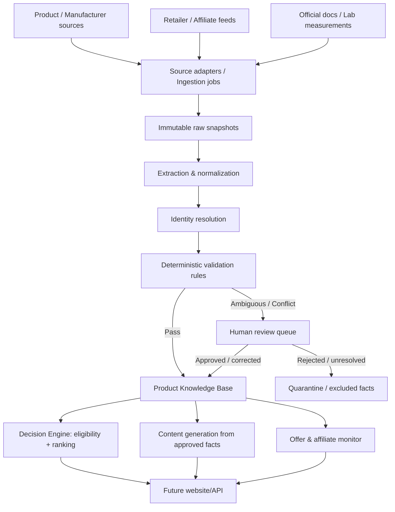
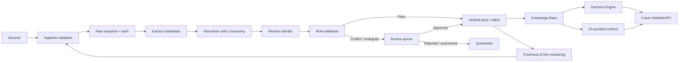

# A+ — Technical Feasibility & Data Architecture Review

**Tài liệu:** `hoang-technical-feasibility-v1.md`  
**Phiên bản:** 1.0 — Draft for CEO review  
**Ngày lập:** 12/11/2026  
**Hạn theo phân công:** 16/11/2026  
**Người phụ trách:** Hoàng — Technical Lead & Data Architecture  
**Phạm vi:** Thẩm định khả thi và đề xuất kiến trúc; không triển khai production  
**Trạng thái đầu vào:** Chưa truy cập được Technical Blueprint và các tài liệu repo để đối chiếu trực tiếp

> **Lưu ý quan trọng về mức độ hoàn tất:** Báo cáo này là bản đánh giá khả thi dựa trên brief nhiệm vụ A+ được cung cấp trong cuộc trao đổi và các nguyên tắc kỹ thuật tham chiếu. Tại thời điểm lập báo cáo, GitHub connector trả về HTTP 403 với thông báo tài khoản bị suspended; thử truy cập bản raw/public cũng không thành công. Do đó Hoàng chưa đọc được 8 tài liệu được liệt kê, đặc biệt là `TECHNICAL-BLUEPRINT-v1.0.md`. Không có nhận xét nào trong phần 1 được xem là kết luận về nội dung thực tế của Blueprint. Cần bổ sung vòng đối chiếu tài liệu trước khi CEO phê duyệt kiến trúc cuối cùng.

---

## Tóm tắt điều hành

A+ có thể tự động hóa phần lớn chuỗi thu thập → chuẩn hóa → kiểm tra → cập nhật → so sánh → tạo nội dung, nhưng **không nên tự động hóa quyết định công bố dữ liệu khi định danh sản phẩm, thông số trọng yếu hoặc giá/offer chưa đủ bằng chứng**. Kiến trúc nên tối ưu cho khả năng truy vết và phục hồi, không tối ưu cho số lượng crawler hay mức độ “AI hóa”.

**Đề xuất chính:**

1. Dùng **modular monolith** trong giai đoạn đầu, một cơ sở dữ liệu quan hệ làm nguồn dữ liệu chuẩn, object storage giữ snapshot nguồn thô, và background jobs để chạy đồng bộ/kiểm tra. Chưa cần microservices.
2. Mô hình hóa riêng `Product Family`, `Product Model`, `Product Variant`, `Merchant Offer`, `Merchant SKU`, `GTIN/MPN` và `Affiliate Link`. Không dùng một trường `product_id` để đại diện cho tất cả.
3. Mỗi thông số là một **fact có bằng chứng**: giá trị gốc, giá trị chuẩn hóa, đơn vị, nguồn cụ thể, thời điểm quan sát, phiên bản parser/schema và trạng thái xác minh. Không lưu một con số “confidence” tổng quát để thay thế bằng chứng.
4. Phân biệt trạng thái `unknown`, `not_disclosed`, `not_applicable`, `stale`, `conflicting` và `verified`. Thiếu dữ liệu không đồng nghĩa với giá trị `false` hoặc `0`.
5. Decision Engine chỉ nhận dữ liệu qua cổng kiểm soát chất lượng. Dữ liệu mâu thuẫn hoặc lỗi định danh phải bị loại khỏi điều kiện lọc/ranking tương ứng; engine có thể trả về “chưa đủ dữ liệu để kết luận”.
6. Chạy pilot 16 model màn hình máy tính, tối thiểu 2 nguồn thông số độc lập cho mỗi model và 1–3 offer theo variant/nhà bán. Pilot phải đo false merge, tỷ lệ field có provenance, xử lý conflict và độ mới của offer.

**Khuyến nghị quyết định:** CEO cho phép thực hiện một pilot kỹ thuật giới hạn (không production) và yêu cầu hoàn tất đối chiếu Blueprint trước khi chốt stack, ngân sách hoặc cam kết tự động hóa diện rộng.

---

## 1. Đánh giá Technical Blueprint hiện tại

### 1.1. Tình trạng thẩm định

| Tài liệu cần đọc | Kết quả truy cập | Ảnh hưởng tới đánh giá |
|---|---|---|
| README — định hướng A+ | Chưa truy cập được | Chưa xác minh được mục tiêu/phạm vi chi tiết ngoài brief |
| PROJECT-CHARTER | Chưa truy cập được | Chưa xác minh được non-goals, success criteria và decision rights |
| WORKFLOW | Chưa truy cập được | Chưa xác minh được quy trình phối hợp/bàn giao chính thức |
| TECHNICAL-BLUEPRINT v1.0 | Chưa truy cập được | Không thể kết luận kiến trúc hiện tại giữ/sửa/bỏ điểm nào |
| ROLE Hoàng | Chưa truy cập được | Đối chiếu trách nhiệm dựa trên brief hiện tại |
| ROLE A Long | Chưa truy cập được | Chưa xác minh taxonomy và quy tắc chuyên môn đã được thống nhất |
| ROLE Vân Anh | Chưa truy cập được | Chưa xác minh logic nhu cầu/ra quyết định của khách hàng |
| ROLE Trâm Anh | Chưa truy cập được | Chưa xác minh danh mục nguồn, API, đối tác affiliate và điều kiện khai thác |

**Không được diễn giải “chưa đọc được” thành “Blueprint chưa có”.** Các mục dưới đây là checklist thẩm định và tiêu chí kiến trúc đích, không phải phát hiện lỗi đã xác nhận.

### 1.2. Checklist đối chiếu Blueprint

| Hạng mục | Tiêu chí để được xem là đạt | Trạng thái hiện tại |
|---|---|---|
| Mở rộng nhiều ngành hàng | Core model độc lập taxonomy; schema/category profile có version; thêm ngành hàng không sửa toàn bộ pipeline | Chưa xác minh |
| Product / Model / Variant / SKU | Có entity và quan hệ riêng; SKU thuộc phạm vi merchant/listing; variant phản ánh khác biệt cấu hình thực | Chưa xác minh |
| Spec theo ngành hàng | Schema có kiểu dữ liệu, đơn vị, enum, validation rule và phiên bản | Chưa xác minh |
| Provenance | Mỗi fact quan trọng liên kết về source snapshot, locator, thời gian, phương thức thu thập | Chưa xác minh |
| Lịch sử | Lưu lịch sử assertion và lần thay đổi; có thể replay, audit và rollback | Chưa xác minh |
| Dữ liệu trùng | Có identity resolution theo mã định danh và quy trình review; fuzzy match không tự merge | Chưa xác minh |
| Dữ liệu mâu thuẫn | Có trạng thái conflict và policy theo từng thuộc tính/loại nguồn | Chưa xác minh |
| Dữ liệu cũ | Có freshness policy theo loại dữ liệu; giá/stock không dùng chung TTL với thông số model | Chưa xác minh |
| Thay đổi nguồn | Connector/adapter tách biệt; nguồn có registry và policy; thay một nguồn không buộc viết lại domain logic | Chưa xác minh |
| AI guardrails | AI không ghi fact xác minh trực tiếp; mọi đề xuất trích xuất đều cần validation/provenance | Chưa xác minh |
| Decision Engine | Đầu vào chỉ là facts đủ điều kiện; hỗ trợ abstain và giải thích kết quả bằng evidence | Chưa xác minh |
| Affiliate monitoring | Link, offer và product identity tách biệt; kiểm tra redirect/status theo domain policy | Chưa xác minh |

### 1.3. Định hướng giữ / sửa / bổ sung

Do chưa có nội dung Blueprint, chưa thể gắn nhãn cụ thể cho từng thành phần hiện hữu. Đề xuất cách xử lý trong vòng review tiếp theo:

- **Giữ** mọi thành phần hiện có nếu đáp ứng được separation of concerns, provenance cấp field, versioning, idempotency và khả năng tái chạy pipeline.
- **Sửa** thiết kế nếu đang dùng một bảng/product object duy nhất cho cả model, variant, listing, merchant SKU, giá và affiliate URL; nếu chỉ giữ một giá trị thông số “hiện tại” mà không lưu lịch sử; hoặc nếu AI output đi thẳng vào dữ liệu được xuất bản.
- **Bổ sung** source registry, immutable raw snapshots, fact assertions, conflict/review queue, freshness policy, schema registry theo ngành hàng, audit log và cơ chế “không đủ dữ liệu để kết luận”.
- **Không ưu tiên** microservices, crawler diện rộng, vector database hoặc agent tự quyết định ở giai đoạn thẩm định/pilot nếu chưa chứng minh được nhu cầu.

### 1.4. Các quyết định cần xác nhận khi có Blueprint

1. Ngành hàng/thị trường triển khai đầu tiên và phạm vi địa lý của giá/offer.
2. Stack/hosting đã được CEO phê duyệt hay mới là giả định kỹ thuật.
3. Nguồn dữ liệu nào được phép sử dụng theo API, hợp đồng, license và điều khoản website.
4. Ai là người phê duyệt taxonomy, spec trọng yếu và conflict theo từng ngành hàng.
5. Điều kiện “đủ bằng chứng” để một fact được Decision Engine sử dụng.

---

## 2. Rủi ro kỹ thuật và dữ liệu của 4 ngành hàng

### 2.1. Nguyên tắc xử lý chung

- **Định danh trước, so sánh sau.** Không so sánh specs của hai model/variant chưa xác định chắc chắn.
- **Bằng chứng gắn với từng fact.** Không chỉ gắn nguồn ở cấp trang sản phẩm; cùng một trang có thể có thông tin về model, variant, giá và nhà bán khác nhau.
- **Độ ưu tiên nguồn phụ thuộc thuộc tính.** Nhà sản xuất thường là nguồn chuẩn cho thông số công bố; nhà bán/affiliate feed phù hợp hơn cho giá và tình trạng offer; phòng lab/reviewer phù hợp hơn cho số đo thực nghiệm. Không áp dụng một “source ranking” duy nhất cho mọi field.
- **Giữ cả raw value và normalized value.** Không ghi đè giá trị nguồn bằng giá trị đã chuyển đổi.
- **Không dùng AI để lấp chỗ trống.** AI có thể trích xuất hoặc đề xuất mapping, nhưng không tự biến dự đoán thành fact.
- **Abstain là kết quả hợp lệ.** Nếu fact bắt buộc thiếu, mâu thuẫn hoặc stale thì không lọc/ranking dựa trên fact đó.

### 2.2. Ma trận tình huống rủi ro

| Tình huống | Phát hiện | Xác minh | Xử lý hệ thống | Khi chuyển người kiểm tra | Khi phải ngừng sử dụng |
|---|---|---|---|---|---|
| Hai model gần giống tên nhưng khác thông số | Match candidate theo brand/model code, suffix, region, release year; tìm conflict về kích thước/cấu hình | Manufacturer part number, product page đúng khu vực, manual/datasheet, GTIN nếu có | Tạo hai candidate riêng; không auto-merge dựa trên similarity tên | Khi thiếu mã định danh hoặc nguồn cho thấy hai cấu hình có thể cùng tên thương mại | Dừng merge và dừng mọi recommendation dựa trên fact chưa gán đúng model |
| Một model có nhiều variant/SKU | Phát hiện nhiều mã GTIN/MPN, khác màu/cấu hình/port/panel/RAM/storage/keyboard | Kiểm tra mã cấu hình trên trang hãng và mapping của merchant | Một Model có nhiều Variant; Offer/SKU gắn đúng variant và seller | Khi không xác định được suffix nào tương ứng cấu hình nào | Ngừng hiển thị thông số variant cụ thể và giá offer không xác định được variant |
| Nguồn cung cấp spec không đồng nhất | So sánh fact cùng thuộc tính, cùng model/variant, cùng điều kiện đo và cùng region | Ưu tiên nguồn theo field policy; kiểm tra manual, datasheet, revision và điều kiện thử nghiệm | Lưu cả assertions; trạng thái `conflicting`; không lấy trung bình/đa số phiếu | Khi hai nguồn có thẩm quyền tương đương hoặc khác điều kiện đo | Không sử dụng field conflict cho hard filter, ranking hoặc claim nội dung |
| Giá cũ/hết hiệu lực | `observed_at`, `valid_until`, lần crawl gần nhất, feed status; phát hiện TTL quá hạn | Đối chiếu API/feed hoặc trang offer của seller | Đóng/hết hiệu lực offer cũ; yêu cầu refresh; hiển thị “cần kiểm tra giá” nếu cần | Khi feed và trang seller lệch giá hoặc không rõ thuế/vận chuyển/voucher | Không hiển thị như giá hiện hành và không dùng để xếp hạng theo giá |
| Sản phẩm ngừng kinh doanh | Lifecycle field, hãng thông báo EOL/discontinued, listing chuyển unavailable | Manufacturer notice/authorized distributor; xác nhận region | Đổi lifecycle status; giữ historical record và offer history | Khi chỉ mất listing ở một seller nhưng chưa có xác nhận EOL | Không gợi ý mua như sản phẩm đang bán; chỉ hiển thị ở ngữ cảnh lịch sử nếu có ích |
| Affiliate link hết hạn/đứt | Scheduled link check, redirect chain, partner API/report, final host/domain | Kiểm tra trên hệ thống affiliate và landing page hợp lệ; phân biệt 403 do bot với 404 thật | Mark `suspect`, `invalid` hoặc `blocked_check`; tạo link mới qua API được phép | Khi redirect đổi domain ngoài allowlist, campaign hết hạn hoặc API không đồng bộ | Ẩn link mua nếu đích cuối không rõ, sản phẩm không đúng hoặc chương trình đã hết hiệu lực |
| AI tự suy diễn thông số | So sánh AI output với evidence span/source field; phát hiện fact không có `evidence_id` | Đối chiếu raw snapshot; kiểm tra trích đoạn nguồn | Reject fact không có provenance; chỉ cho phép AI output ở trạng thái candidate | Bất cứ claim trọng yếu nào AI đề xuất nhưng chưa đối chiếu được | Không xuất bản và không đưa vào Decision Engine |
| Thiếu dữ liệu nhưng hệ thống vẫn kết luận | Required-field gate; detect null/unknown; test rule path | Xác định field nào là hard constraint, field nào optional theo policy đã duyệt | Mark `insufficient_evidence`; engine abstain hoặc trả kết quả có giới hạn | Khi thiếu field ảnh hưởng trực tiếp đến tiêu chí khách hàng | Không đưa ra kết luận chắc chắn; không suy ra “không có” từ “không biết” |

### 2.3. Rủi ro đặc thù theo ngành hàng

| Ngành hàng | Rủi ro đặc thù cần kiểm tra | Quy tắc dữ liệu đề xuất |
|---|---|---|
| Màn hình máy tính | Tên model có suffix/region; độ phân giải native khác khả năng nhận tín hiệu; tần số native/overclock; panel revision; HDR support không tương đương chứng nhận/chất lượng HDR; cổng USB-C và công suất PD thay đổi theo SKU | Lưu resolution H×V, refresh rate kèm điều kiện/native-vs-OC, panel type và revision nếu có, HDR certification tách khỏi “HDR compatible”, port và USB-PD wattage riêng; không gộp các suffix chưa đối chiếu |
| Thiết bị âm thanh | Cùng model name nhưng khác driver/cấu hình; codec phụ thuộc thiết bị nguồn/firmware; công suất phụ thuộc trở kháng/điều kiện đo; đáp tuyến có thể là claim hãng hoặc đo độc lập; phiên bản Bluetooth/firmware thay đổi | Tách cấu hình driver, codec support và điều kiện tương thích; lưu riêng công suất danh định/đỉnh và điều kiện đo; gắn nguồn cho response curve/sensitivity/impedance; phân biệt claim manufacturer với independent measurement |
| Máy lọc không khí | CADR khác theo smoke/dust/pollen hoặc phương pháp đo; diện tích phòng là khuyến nghị theo ACH/chiều cao trần; bộ lọc tương thích khác mã; hiệu quả lọc không đồng nghĩa khử mùi; ionizer/ozone có thể là tính năng riêng | Lưu CADR theo loại hạt và tiêu chuẩn/điều kiện test; coverage area kèm giả định ACH/room height nếu nguồn có; mã filter replacement và tương thích theo model; trạng thái ozone/ionizer riêng, không suy từ marketing copy |
| Laptop | Cùng tên dòng có CPU/GPU/TGP, RAM soldered/slot, màn hình, pin, wireless và layout bàn phím khác; cấu hình theo region; mức hiệu năng chịu ảnh hưởng profile/thermal/power | Variant phải khóa theo part number hoặc mã cấu hình; CPU/GPU là SKU component chính xác; RAM capacity và upgradeability tách riêng; battery capacity (Wh) và claimed/runtime test tách riêng; panel resolution/refresh/brightness/color gamut cần provenance riêng |

---

## 3. Kiến trúc dữ liệu dùng chung và riêng

### 3.1. Kiến trúc khái niệm



### 3.2. Cấu trúc entity khuyến nghị

| Entity | Ý nghĩa | Khóa/quan hệ quan trọng |
|---|---|---|
| `Brand` | Thương hiệu | Internal ID; canonical name; aliases |
| `ProductFamily` | Dòng/nhóm sản phẩm được marketing dưới cùng family | Brand; family name; category |
| `ProductModel` | Model cụ thể ở mức nhà sản xuất công bố | Brand + manufacturer model code + region/revision scope |
| `ProductVariant` | Cấu hình khác biệt có tác động tới thông số/khả năng sử dụng | Belongs to ProductModel; variant code/configuration signature |
| `ProductIdentifier` | Mã định danh gắn với model/variant hoặc trade item | Identifier type + issuer/scope + value; gồm GTIN/EAN/UPC/MPN tùy trường hợp |
| `Merchant` | Nhà bán/đối tác thương mại | Merchant ID; domain; market |
| `MerchantOffer` | Một offer tại một merchant, có giá/tình trạng riêng | Merchant + variant/trade item + observed time; có lịch sử |
| `MerchantSKU` | SKU nội bộ của nhà bán | Unique trong phạm vi merchant, không coi là global product ID |
| `AffiliateLink` | Link tracking cho offer/campaign | Partner/program, target offer, URL, status, checked_at, expiry |
| `AttributeDefinition` | Định nghĩa thuộc tính theo category/version | Key, type, unit, allowed values, requiredness, validation rules |
| `FactAssertion` | Một khẳng định về một thuộc tính của một entity | Entity + attribute + original value + normalized value + source evidence + status |
| `Source` / `SourceSnapshot` | Nguồn và bản chụp nội dung tại thời điểm lấy | URL/API endpoint, source type, fetched_at, content hash, raw object location |
| `ReviewCase` | Trường hợp cần người xác minh | Reason, candidate values, assignee/decision, audit history |

**Phân biệt bắt buộc:**

- `ProductModel` không đồng nghĩa `ProductVariant`.
- `GTIN/EAN/UPC` là định danh trade item; cần gắn theo scope đúng, không tự giải mã thành specs.
- `MPN` là mã nhà sản xuất, phải lưu manufacturer/brand scope.
- `MerchantSKU` là mã của merchant/listing; không dùng nó làm identity toàn hệ thống.
- `MerchantOffer` là trạng thái thương mại có thể thay đổi theo thời gian; không gắn giá vào ProductModel cố định.

### 3.3. Mô hình fact và provenance

Mỗi fact quan trọng nên lưu tối thiểu:

| Trường | Mục đích |
|---|---|
| `fact_id` | ID bất biến của assertion |
| `subject_type`, `subject_id` | Model, variant hoặc offer đang được mô tả |
| `attribute_key`, `schema_version` | Thuộc tính và phiên bản định nghĩa |
| `raw_value`, `raw_unit` | Giá trị/đơn vị lấy nguyên từ nguồn |
| `normalized_value`, `normalized_unit` | Giá trị chuẩn để lọc/so sánh |
| `value_type` | string, decimal, integer, boolean, enum, object |
| `evidence_id` | Tham chiếu đến source snapshot/claim cụ thể |
| `source_locator` | URL, JSONPath, CSS selector, trang manual hoặc đoạn trích |
| `observed_at`, `published_at` | Lúc hệ thống quan sát và lúc nguồn công bố (nếu biết) |
| `valid_from`, `valid_until` | Khoảng thời gian fact/offer có hiệu lực nếu nguồn cung cấp |
| `status` | `candidate`, `verified`, `corroborated`, `conflicting`, `stale`, `rejected`, `unknown` |
| `extraction_method`, `parser_version` | Parser/AI model/prompt version tạo candidate |
| `reviewed_by`, `reviewed_at` | Người duyệt và thời điểm, nếu có |

Không cần triển khai ngay toàn bộ W3C PROV; tuy nhiên nên thiết kế theo tư duy provenance entity/activity/agent để có thể truy lại dữ liệu được tạo bởi nguồn nào, job/parser nào và ai phê duyệt. W3C PROV-DM mô tả các khái niệm entity, activity và agent cho mục đích biểu diễn provenance [R1].

### 3.4. Trạng thái dữ liệu

| Trạng thái | Ý nghĩa | Dùng trong Decision Engine? |
|---|---|---|
| `verified` | Đã kiểm tra theo source policy; identity và evidence hợp lệ | Có, trong phạm vi/TTL policy |
| `corroborated` | Có nhiều nguồn độc lập tương thích và không có conflict chưa xử lý | Có, nếu field policy cho phép |
| `candidate` | Trích xuất/AI/parser mới đề xuất, chưa qua xác minh | Không |
| `conflicting` | Hai hay nhiều assertion không đồng thuận hoặc khác scope chưa phân giải | Không cho filter/ranking liên quan |
| `stale` | Quá freshness TTL hoặc hiệu lực hết hạn | Không, trừ khi engine chỉ dùng để lịch sử và gắn nhãn |
| `unknown` | Chưa có thông tin | Không; không coi là false/zero |
| `not_disclosed` | Đã kiểm tra nhưng nguồn không công bố | Không thể dùng để chứng minh có/không |
| `not_applicable` | Thuộc tính không áp dụng cho entity này | Không dùng trong điều kiện tiêu chí |
| `rejected` | Fact không đạt validation hoặc bị review bác bỏ | Không |

### 3.5. Cấu trúc dùng chung và riêng theo ngành

**Trường dùng chung**

| Nhóm | Trường tối thiểu đề xuất |
|---|---|
| Identity | brand, family, model code, display name, category, region, release/status nếu có nguồn |
| Variant | variant code, configuration summary, identifiers, region, distinguishing attributes |
| Commercial | merchant, offer URL, merchant SKU, GTIN nếu có, price, currency, availability, shipping/condition nếu nguồn có |
| Provenance | source, source type, source locator, observed_at, published_at, raw snapshot hash, parser/schema version |
| Quality | field status, validation errors, conflict group, last_verified_at, reviewer |
| Lifecycle | active, discontinued, end-of-life, unknown; tách lifecycle của model khỏi availability của offer |

**Profile riêng theo ngành**

| Nhóm field | Màn hình | Âm thanh | Máy lọc không khí | Laptop |
|---|---|---|---|---|
| Kích thước/cấu trúc | diagonal, aspect ratio, panel type, curvature, weight | driver count/type, form factor, enclosure | dimensions, weight, room placement | display size, chassis, weight |
| Hiệu năng chính | native resolution, refresh rate, response-time claim/test, brightness, contrast, color gamut | frequency response, sensitivity, impedance, SPL, power, ANC metrics nếu có | CADR theo particulate type, airflow, ACH/coverage assumptions | CPU, GPU, TGP/power profile, memory bandwidth nếu có |
| Hiển thị/lọc âm/không khí | HDR support/certification, color depth, calibration | codec, Bluetooth version/profile, wired/wireless modes | filter stages, HEPA class/claim, activated carbon, ionizer/ozone | panel type, resolution, refresh, brightness, color gamut |
| Kết nối | HDMI/DP/USB-C version, USB PD watts, KVM | Bluetooth, USB, analog, wireless protocol | Wi-Fi/app, sensor types, controls | ports and versions, Wi-Fi, Bluetooth, cellular if present |
| Năng lượng/vật tư | power draw, adapter | battery/runtime or power supply | power draw, filter replacement code/life | battery Wh, adapter wattage, replacement battery/charger |
| Điều kiện đo | refresh/native vs OC, HDR mode, brightness mode | measurement standard, load/impedance, codec/source | test standard and particulate type, room height/ACH | benchmark method, power profile, ambient/thermal conditions |

### 3.6. Quy tắc schema

- Mỗi category profile được quản lý như cấu hình có version (`monitor.v1`, `laptop.v1`...), không hard-code field trong mọi tầng hệ thống.
- Mỗi field có `type`, `unit`, `enum`, `required_for_decision`, `source_policy`, `freshness_policy`, `validation_rules` và `display_label`.
- Giá trị số phải có unit rõ ràng; lưu cả raw và normalized. Không trộn `inches` với `mm`, `W` với `mW`, hoặc đơn vị chưa rõ.
- Dùng JSON Schema để kiểm tra cấu trúc payload và kiểu dữ liệu; JSON Schema Draft 2020-12 là phiên bản hiện hành được trang đặc tả chính thức liệt kê [R2]. JSON Schema không thay thế logic nghiệp vụ như kiểm tra đúng model hoặc conflict giữa nguồn.
- Có thể dùng `JSONB` cho phần mở rộng/category payload nhưng facts, provenance, identifiers, offer và audit nên có cấu trúc quan hệ rõ để query, index và kiểm toán.

---

## 4. Quy trình tự động hóa đề xuất

### 4.1. Pipeline



### 4.2. Quyền hạn theo công đoạn

| Công đoạn | Tự động hoàn toàn | AI hỗ trợ | Quy tắc bắt buộc | Con người |
|---|---|---|---|---|
| Thu thập API/feed | Lấy dữ liệu, retry, rate limit, snapshot, hash, lịch chạy | Phân loại nguồn/field khi cần | Allowlist nguồn, điều khoản sử dụng, schema, idempotency | Cấp quyền/API key, duyệt nguồn mới và scope pháp lý |
| Thu thập trang web | Chỉ khi được phép và ổn định | Trích xuất nội dung không có API | robots/terms, rate limit, snapshot, parser version | Phê duyệt cách khai thác nguồn và xử lý khi cấu trúc trang đổi |
| Chuẩn hóa | Mapping xác định, unit conversion, enum mapping | Đề xuất mapping field lạ/alias | Type/unit/range/enum validation | Duyệt mapping mới có ảnh hưởng tới nghĩa của field |
| Phát hiện trùng | Exact match theo ID đã xác minh | Xếp hạng candidate dựa similarity | Không auto-merge chỉ bằng tên gần giống | Duyệt fuzzy/ambiguous merge và split |
| Kiểm tra specs | Range, type, cross-field, freshness, conflict detection | Extract fact + evidence span | Source policy và gate trạng thái | Duyệt conflict trọng yếu hoặc thay đổi rule chuyên môn |
| Cập nhật giá/stock | Feed/API sync, TTL, trạng thái lịch sử | Parse khi feed không đồng nhất | Offer identity, currency, valid time, TTL | Xử lý mismatch/offer đặc biệt và nguồn không rõ |
| Đánh giá phù hợp | Hard filters/ranking đã được duyệt | Tóm tắt lý do theo facts đã duyệt | Không dùng unknown/conflict/stale cho điều kiện bắt buộc | A Long/Vân Anh duyệt taxonomy, tiêu chí và test case |
| Tạo nội dung | Template/format/links từ dữ liệu đã duyệt | Viết nháp, diễn giải, tóm tắt so sánh | Mỗi claim phải map được về fact/evidence | Duyệt nội dung có claim nhạy cảm hoặc kết quả mới |
| Kiểm tra affiliate link | Kiểm tra lịch trình, redirect, status, expiry | Phân loại lỗi bất thường | Domain allowlist, kiểm tra final URL, không bỏ qua blocked check | Trâm Anh xác minh campaign, partner policy và link thay thế |

### 4.3. Các bước vận hành cụ thể

1. **Source registry:** lưu source type, domain/API, field authority, region, access policy, terms/contract owner, rate limit, parser, lịch đồng bộ và tình trạng vận hành.
2. **Ingestion run:** mỗi lần chạy có `run_id`, source, timestamp, version connector, trạng thái, số bản ghi, lỗi và retry count. Job phải idempotent để rerun không tạo bản ghi trùng.
3. **Raw snapshot:** lưu payload/HTML/JSON gốc trong object storage, kèm URL, fetched_at, hash, content type, locale và source locator. Không chỉ lưu text parser đã trích.
4. **Extraction candidate:** rule parser là ưu tiên cho feed cấu trúc; AI chỉ xử lý phần bán cấu trúc và trả về JSON theo schema cùng evidence span.
5. **Normalization:** chuẩn đơn vị, alias và enum; giữ raw value; mọi phép chuyển đổi ghi nhận transform/version.
6. **Identity resolution:** exact identifier first; candidate matching second; fuzzy match chỉ tạo review case, không merge tự động.
7. **Validation:** structural/schema validation, type/range checks, cross-field checks, source policy, freshness và conflict checks.
8. **Review queue:** người có chuyên môn quyết định merge/split/accept/reject. Quyết định lưu audit log; không sửa mất assertion cũ.
9. **Publish gate:** chỉ `verified`/`corroborated` theo field policy mới được xuất bản hoặc đưa vào Decision Engine.
10. **Monitoring & replay:** theo dõi tỷ lệ lỗi nguồn, schema drift, parser drift, stale facts, conflict backlog và link failure. Có thể chạy lại từ raw snapshot khi parser/rule được sửa.

### 4.4. Xử lý nguồn dữ liệu lỗi hoặc mất truy cập

- Retry có exponential backoff và jitter; giới hạn số lần retry, không loop liên tục.
- Dùng circuit breaker để tạm ngừng nguồn lỗi, thông báo trạng thái và giữ dữ liệu đã xác minh nhưng đánh dấu tuổi dữ liệu tăng lên.
- Không thay thế dữ liệu nguồn thất bại bằng dữ liệu AI dự đoán hoặc một nguồn không cùng authority.
- Tách trạng thái `source_unavailable` khỏi `product_unavailable` và `offer_out_of_stock`.
- Giá/stock quá TTL thì không còn được hiển thị như thông tin hiện hành; product specs ổn định có thể tiếp tục dùng trong thời hạn riêng nhưng cần trạng thái freshness rõ.
- Nếu source thay đổi schema hoặc selector, cách ly batch mới để kiểm tra, không tự động ghi đè canonical facts.

### 4.5. Kiến trúc triển khai khuyến nghị cho giai đoạn đầu

**Modular monolith + background workers** là lựa chọn mặc định:

- Một ứng dụng backend chia module: `sources`, `catalog`, `identity`, `facts`, `offers`, `validation`, `review`, `decision`, `publishing`, `monitoring`.
- PostgreSQL làm transactional source of truth; có thể dùng JSONB cho phần mở rộng đã kiểm soát.
- Object storage giữ raw snapshots và tài liệu nguồn.
- Job runner/queue cho đồng bộ, parse, validation, link check và refresh. Có thể bắt đầu bằng scheduler + worker trong cùng codebase.
- Admin/review interface rất nhỏ để xử lý conflict và duyệt mapping; không cần website production.
- Search/indexing và cache chỉ bổ sung khi pilot chứng minh query latency là vấn đề.

**Chưa khuyến nghị:** microservices riêng cho từng category, vector database như kho facts chính, event streaming phức tạp hoặc agent tự quyết định merge/approve. Có thể xem lại khi volume, team boundaries hoặc yêu cầu scale thực tế chứng minh cần thiết.

---

## 5. Đề xuất thử nghiệm kỹ thuật: 16 sản phẩm màn hình máy tính

### 5.1. Vì sao chọn màn hình

Màn hình có schema tương đối dễ giới hạn cho pilot nhưng vẫn đủ tình huống để kiểm tra model suffix, variant, panel/region, tần số quét, resolution, HDR và cổng kết nối. Đây là lựa chọn để kiểm chứng data model; không hàm ý A+ phải chọn màn hình làm ngành hàng kinh doanh đầu tiên.

### 5.2. Phạm vi mẫu

Chọn **16 Product Model** cùng A Long và Trâm Anh, chưa điền tên model cụ thể trong tài liệu này để tránh tự bịa danh mục sản phẩm hoặc ngầm xác nhận thị trường/nguồn. Phân bổ mẫu:

| Nhóm mẫu | Số model | Mục đích kiểm tra |
|---|---:|---|
| Phổ thông/office | 4 | Thông số cơ bản, khác biệt model gần tên |
| Gaming/high refresh | 4 | Native vs overclock refresh, response-time claim và port |
| Creator/color-focused | 4 | Gamut, bit depth, calibration và nguồn measurement |
| Ultrawide/high resolution | 4 | Aspect ratio, resolution, curvature và suffix/variant |
| **Tổng** | **16** | |

Mỗi model: tối thiểu 2 nguồn thông số (ưu tiên manufacturer page/manual + nguồn thứ hai có thể xác minh) và 1–3 offers nếu có nguồn affiliate/merchant hợp lệ. Không cố tạo đủ offer khi thị trường không có dữ liệu đáng tin.

### 5.3. Schema pilot

```json
{
  "schema_version": "monitor.v1",
  "product_model": {
    "brand": "<source-backed brand>",
    "manufacturer_model_code": "<exact code from manufacturer source>",
    "region": "<region or unknown>",
    "display_name": "<source-backed name>"
  },
  "variant": {
    "variant_code": "<exact suffix/configuration or unknown>",
    "identifiers": [
      {"type": "MPN", "issuer": "<manufacturer>", "value": "<source-backed value>"},
      {"type": "GTIN", "issuer": "GS1", "value": "<if observed>"}
    ]
  },
  "facts": [
    {
      "attribute_key": "display.native_resolution",
      "raw_value": "<verbatim source value>",
      "normalized_value": {"horizontal": null, "vertical": null},
      "normalized_unit": "pixel",
      "status": "candidate",
      "evidence_id": "<source snapshot + locator>"
    },
    {
      "attribute_key": "display.refresh_rate_native_hz",
      "raw_value": "<verbatim source value>",
      "normalized_value": null,
      "normalized_unit": "Hz",
      "status": "unknown",
      "evidence_id": null
    }
  ],
  "offers": [],
  "quality": {"identity_status": "pending", "review_status": "not_reviewed"}
}
```

Đây là **fixture cấu trúc**, không phải record của một sản phẩm thật; các placeholder không phải thông số.

### 5.4. Dữ liệu đầu vào mẫu và chuẩn hóa

| Raw input (fixture) | Normalized | Quy tắc |
|---|---|---|
| `31.5 in` | `31.5`, unit `in` | Parse decimal và giữ raw string; không làm tròn trước khi lưu |
| `3840 × 2160` | `horizontal=3840`, `vertical=2160`, unit `pixel` | Chuẩn hóa dấu nhân và lưu hai chiều |
| `165 Hz (OC)` | `value=165`, `mode=overclocked` | Không gán vào field native refresh rate |
| `USB-C, 90 W power delivery` | port `USB-C`; PD `90 W` | Tách connector khỏi power delivery |
| Không thấy HDR certification trong nguồn | `status=not_disclosed` hoặc `unknown` | Không suy ra “không hỗ trợ HDR” |

Ví dụ trên mô tả quy tắc xử lý chuỗi giả lập, không khẳng định thông số của model bất kỳ.

### 5.5. Phát hiện dữ liệu thiếu và mâu thuẫn

**Thiếu dữ liệu:** schema đánh dấu field bắt buộc theo mục đích. Ví dụ, nếu một use case yêu cầu độ phân giải, engine chỉ xem xét candidate có resolution ở trạng thái `verified`/`corroborated`. Nếu chưa có, trạng thái là `unknown`; không tự điền theo model gần giống.

**Mâu thuẫn:** giả sử hai nguồn fixture cho cùng candidate model nhưng một nguồn khai `refresh_rate=144 Hz`, nguồn khác `165 Hz`. Pipeline không chọn giá trị cao hơn, không tính trung bình và không lấy đa số. Trước tiên kiểm tra:

1. Hai nguồn có cùng exact model code và variant suffix không?
2. Một giá trị là native, giá trị còn lại là overclocked không?
3. Có khác region/revision hoặc mode đo không?
4. Nguồn có thẩm quyền đối với field này không?

Nếu chưa phân giải được, giữ hai assertion với status `conflicting`, tạo `ReviewCase`, và block field đó trong Decision Engine.

### 5.6. Ví dụ đầu ra khi chưa xác minh được

```json
{
  "candidate_model_id": "internal-candidate-id",
  "identity_status": "ambiguous",
  "facts": {
    "display.refresh_rate_native_hz": {
      "status": "conflicting",
      "usable_for_decision": false,
      "assertions": [
        {"value": 144, "unit": "Hz", "evidence_id": "source-A-claim"},
        {"value": 165, "unit": "Hz", "evidence_id": "source-B-claim"}
      ]
    }
  },
  "decision_eligibility": {
    "refresh_rate_hard_filter": "blocked_insufficient_evidence",
    "publish_spec_claim": false
  },
  "next_action": "human_review"
}
```

Đây là tình huống giả lập. `source-A-claim` và `source-B-claim` là ID minh họa, không đại diện cho nguồn thật.

### 5.7. Kịch bản test và tiêu chí đạt

| Test | Input | Kỳ vọng | Tiêu chí đạt pilot |
|---|---|---|---|
| Exact identity | Cùng MPN/GTIN và cùng scope | Map về cùng entity đúng | Không tạo duplicate do format tên khác nhau |
| Near-name collision | Hai model tên gần giống, mã khác | Tách entity | Không có false merge do fuzzy match |
| Variant separation | Cùng family/model nhưng suffix khác và spec khác | Tạo variant riêng hoặc review case | Không gắn nhầm fact/offer giữa variants |
| Unit normalization | Inch/mm, Hz, W, resolution | Chuẩn hóa mà giữ raw | 100% conversion test fixtures có expected output |
| Missing required field | Field chưa có evidence | `unknown` và block tương ứng | Không có fact tự điền |
| Contradictory sources | Hai claim không đồng nhất | `conflicting` + review queue | 100% conflict test cases không đi thẳng vào engine |
| Stale offer | Offer quá TTL | Stale/hidden from current price ranking | Không hiển thị giá cũ như giá hiện hành |
| Invalid affiliate link | Redirect sai target hoặc domain ngoài allowlist | Mark suspect/invalid; ẩn CTA | Link không an toàn không xuất bản |
| AI unsupported claim | AI trả field không có evidence | Reject | 0 AI-only fact được publish |
| Replay | Re-run snapshot với parser version mới | Có revision mới, không mất lịch sử | Trace được input, transform và output version |

**Gate đề xuất để kết thúc pilot:**

- 0 false merge không được phát hiện trong 16 model thuộc test set; mọi match mơ hồ được đẩy review.
- 100% fact trọng yếu được hiển thị trong pilot có source locator, observed_at và status.
- 100% fixture conflict bị block khỏi hard filter/ranking cho field tương ứng.
- 0 AI-only facts được đưa vào canonical verified facts hoặc nội dung publishable.
- Offer được đánh dấu stale khi vượt TTL policy; link có checked_at và kết quả check.
- A Long xác nhận schema/field meaning; Trâm Anh xác nhận source/affiliate feasibility; Vân Anh xác nhận các tiêu chí lọc có nghĩa với nhu cầu người dùng.

Các tỷ lệ này là **mục tiêu nghiệm thu thử nghiệm**, không phải số liệu hiệu năng đã đo.

### 5.8. Deliverables pilot (không phải production)

1. Category schema `monitor.v1` và test fixtures.
2. Danh sách 16 model do A Long/Trâm Anh xác nhận, kèm source inventory.
3. Raw snapshot và normalized assertion sample.
4. Báo cáo entity matching, missing fields, conflicts, freshness và affiliate check.
5. Demo quyết định rule-based có giải thích và abstain; không triển khai website.
6. Khuyến nghị go/no-go cho mở rộng sang 3 ngành hàng còn lại.

---

## 6. Bảng đánh giá khả năng tự động hóa

| Công đoạn | Mức tự động hóa | Điều kiện/giới hạn |
|---|---|---|
| Thu thập sản phẩm | **Tự động được** với API/feed; **AI hỗ trợ** với trang bán cấu trúc | Cần source registry, quyền khai thác, rate limit, schema drift monitor; crawler web không phải nguồn mặc định |
| Chuẩn hóa dữ liệu | **Tự động được** với field/unit đã định nghĩa; **AI hỗ trợ** field mới/khó parse | Mọi mapping mới phải qua validation; giữ raw value; cần human approve khi thay đổi ngữ nghĩa field |
| Phát hiện trùng lặp | **Tự động được** cho exact identifier; **AI hỗ trợ** candidate discovery | Fuzzy score không được tự merge; trường hợp ambiguity phải người duyệt |
| Kiểm tra thông số | **Tự động được** cho type/range/cross-field/source/freshness checks; **AI hỗ trợ** trích xuất | Conflict, model suffix, điều kiện đo và field trọng yếu cần kiểm chứng theo nguồn hoặc con người |
| Cập nhật giá | **Tự động được** khi affiliate/merchant API feed ổn định | Giá phải có currency, merchant, observed_at, validity/TTL; mismatch hoặc voucher phức tạp cần review |
| Đánh giá độ phù hợp | **AI hỗ trợ, cần kiểm chứng**; hard filters có thể chạy tự động theo rule đã duyệt | Vân Anh/A Long phải xác nhận tiêu chí; không dùng unknown/conflict/stale; phải giải thích và có abstain |
| Tạo nội dung | **AI hỗ trợ, cần kiểm chứng** | Chỉ sinh từ verified facts; claim nào cũng map về evidence; giai đoạn đầu cần human approval |
| Kiểm tra affiliate link | **Tự động một phần**; partner API có thể xác minh mạnh hơn | HTTP status/redirect không đủ kết luận link sống; phân biệt bot-blocked/403 với invalid; campaign/target phải xác minh |

**Kết luận mức tự động hóa:** A+ có thể tự động hóa quy trình vận hành, nhưng không nên đặt mục tiêu “100% không cần người” đối với định danh, conflict, source policy và nội dung khuyến nghị. Mục tiêu thực tế là **human-in-the-loop có chọn lọc**, nơi con người xử lý ngoại lệ và AI/rules đảm nhận phần lặp lại, có thể kiểm chứng.

---

## 7. Các vấn đề phải giải quyết trước production

### 7.1. Gate kiến trúc và governance

- Hoàn tất đọc/đối chiếu Technical Blueprint v1.0, Project Charter, Workflow và role docs; tạo bảng mapping yêu cầu → thành phần kiến trúc → người chịu trách nhiệm.
- CEO duyệt ngành hàng, thị trường, phạm vi MVP, ngân sách và success metrics.
- A Long duyệt taxonomy, field definitions, thuật ngữ và các rule chuyên môn cho ngành đầu tiên.
- Vân Anh duyệt tiêu chí nhu cầu, hard constraints/soft preferences và cách diễn giải “phù hợp”.
- Trâm Anh xác nhận nguồn hợp lệ, affiliate partner/API, quyền sử dụng dữ liệu, freshness thực tế và link lifecycle.
- Xác định owner cho từng source, field policy và conflict escalation.

### 7.2. Gate dữ liệu

- Có source inventory được phê duyệt và đánh giá điều khoản sử dụng; không triển khai crawler trước khi xác nhận quyền/trách nhiệm.
- Có data dictionary, category schema versioning và unit conventions.
- Đã thống nhất Product/Model/Variant/Trade item/Offer/SKU boundaries.
- Có identity rules, manual merge/split workflow và audit history.
- Có provenance bắt buộc cho mọi fact trọng yếu.
- Có conflict policy theo field/source class, freshness TTL và lifecycle definitions.
- Có cơ chế xóa/ẩn/điều chỉnh dữ liệu khi nguồn rút lại hoặc phát hiện sai.

### 7.3. Gate kỹ thuật và vận hành

- Idempotent ingestion, retry/backoff, circuit breaker, replay và alerting.
- Schema validation + business rules + quarantine/review queue.
- Access control cho API keys, secrets, raw snapshots và thao tác review.
- Audit log bất biến ở mức cần thiết; backup/restore test.
- Monitoring cho stale facts, source failures, parser drift, false matches, conflict backlog và affiliate link status.
- Có bộ test fixture cho model gần tên, variant, source conflict, missing data, stale price và link fail.
- Có kill switch để ngừng publish một source, field hoặc category khi phát hiện lỗi diện rộng.

### 7.4. Gate Decision Engine và nội dung

- Tách hard constraints khỏi soft preferences.
- Có policy xác định fact status nào đủ điều kiện sử dụng theo từng loại field.
- Không suy diễn giá trị từ dữ liệu tương tự; missing không phải false.
- Mỗi recommendation reason có thể truy về fact/evidence.
- Có test case “không đủ dữ liệu” và output abstain.
- AI content được giới hạn vào facts đã duyệt; kiểm tra liên kết claim → fact → source.
- Chưa công bố so sánh tự động cho tới khi pilot đạt gate.

### 7.5. Gate thương mại/affiliate

- Mỗi offer có seller, SKU, currency, observed_at, validity/TTL và status.
- Affiliate link gắn đúng offer/variant và campaign.
- Có allowlist domain, kiểm tra redirect cuối và cơ chế xử lý link suspect.
- Phân biệt out-of-stock, discontinued, seller page unavailable và partner link expired.
- Trâm Anh xác nhận chính sách thay link, campaign expiry và dữ liệu conversion/reporting.

---

## Đề xuất quyết định gửi CEO

| Quyết định | Đề xuất |
|---|---|
| Chọn kiến trúc | Duyệt định hướng modular monolith + PostgreSQL + object storage + background jobs cho pilot; chưa duyệt microservices |
| Chọn mô hình dữ liệu | Duyệt phân tách Model / Variant / Offer / Merchant SKU / Identifier / Fact Assertion / Evidence |
| Chọn ngành pilot | Duyệt màn hình máy tính làm pilot kỹ thuật 16 model, với điều kiện A Long và Trâm Anh xác nhận danh sách/source |
| Tiêu chí dữ liệu | Duyệt nguyên tắc “no evidence, no verified fact”; conflict/unknown/stale không đi vào decision path cần field đó |
| Production | Chưa phê duyệt triển khai production trước khi hoàn tất Blueprint review và pilot gate |
| Tài liệu đầu vào | Yêu cầu khôi phục quyền truy cập repo hoặc cung cấp bản export của 8 tài liệu để Hoàng hoàn tất phần đánh giá hiện trạng |

**Kết luận:** Rủi ro lớn nhất của A+ không nằm ở khả năng lấy dữ liệu hay gọi AI, mà nằm ở việc gắn sai dữ liệu vào sai model/variant rồi tạo ra một khuyến nghị có vẻ rất thuyết phục. Vì vậy, nền tảng phải thiết kế quanh identity, provenance, versioning, conflict handling và khả năng từ chối kết luận. Khi các lớp này được chứng minh ở pilot, tự động hóa mở rộng sang bốn ngành hàng sẽ có cơ sở kỹ thuật đáng tin cậy hơn.

---

## Tài liệu tham chiếu kỹ thuật

- **[R1] W3C — PROV-DM: The PROV Data Model.** Khung khái niệm provenance gồm entity, activity, agent và quan hệ giữa chúng. https://www.w3.org/TR/prov-dm/
- **[R2] JSON Schema — Specification.** Trang đặc tả hiện liệt kê Draft 2020-12 là phiên bản hiện hành; phù hợp làm lớp kiểm tra cấu trúc/type, không thay cho kiểm tra nghiệp vụ. https://json-schema.org/specification
- **[R3] GS1 — EAN-13/UPC-A và GTIN.** Mô tả GTIN được dùng để nhận diện trade item; các biến thể như màu, kích thước, trọng lượng hoặc presentation có thể có item reference khác. https://support.gs1.org/support/solutions/articles/43000734137-what-is-the-gs1-barcode-commonly-used-for-trade-item-identification-
- **[R4] Schema.org — Offer.** Có các thuộc tính hữu ích để tham chiếu cho offer như `availability`, `priceValidUntil`, `seller`, `sku`, `validFrom` và `validThrough`; đây là vocabulary tham chiếu, không thay cho schema nội bộ của A+. https://schema.org/Offer
- **[R5] Google Search Central — Product structured data.** Hướng dẫn các giá trị availability, currency ISO 4217 và `priceValidUntil` trong product structured data. https://developers.google.com/search/docs/appearance/structured-data/product-snippet

---

## Phụ lục A — Các câu hỏi cần trả lời trong buổi review Blueprint

1. Blueprint hiện dùng Product, Product Variant, SKU, Offer và Affiliate URL như những entity nào? Khóa định danh của mỗi entity là gì?
2. Raw data có được lưu bất biến không? Có thể replay parser sau khi sửa mà không truy cập lại nguồn không?
3. Fact đang được lưu ở cấp product, model hay variant? Có field-level evidence và thời điểm quan sát không?
4. Cơ chế conflict hiện tại là gì? Có phân biệt xung đột do khác region/variant/measurement mode không?
5. AI output hiện đi vào trạng thái nào? Có gate để ngăn fact chưa xác minh được publish không?
6. Có versioning cho category schema và parser/mapping không?
7. Data source có registry, owner, terms/access policy và field authority không?
8. Decision Engine có thể trả về abstain/insufficient evidence không?
9. Affiliate link monitor có theo dõi final destination, campaign expiry và đúng variant/offer không?
10. Có cơ chế kill switch theo source/field/category và audit log cho thao tác review không?

## Phụ lục B — Glossary

| Thuật ngữ | Định nghĩa dùng trong tài liệu |
|---|---|
| Product Family | Dòng sản phẩm hoặc nhóm marketing có liên quan |
| Product Model | Model xác định bởi nhà sản xuất, không nhất thiết chỉ có một cấu hình bán ra |
| Product Variant | Phiên bản/cấu hình cụ thể khác biệt về thuộc tính có ý nghĩa |
| GTIN | Global Trade Item Number; mã định danh trade item |
| MPN | Manufacturer Part Number; mã model/part do nhà sản xuất cấp |
| Merchant SKU | Mã sản phẩm nội bộ trong hệ thống nhà bán |
| Offer | Một đề nghị bán cụ thể với seller, giá, availability và thời gian hiệu lực |
| Fact Assertion | Một khẳng định có cấu trúc về một field, có provenance và trạng thái xác minh |
| Provenance | Thông tin nguồn gốc và quá trình tạo/biến đổi dữ liệu |
| Freshness TTL | Khoảng thời gian tối đa để dữ liệu được coi là còn mới cho mục đích sử dụng cụ thể |
| Abstain | Từ chối kết luận khi dữ liệu chưa đủ hoặc không đáng tin |
